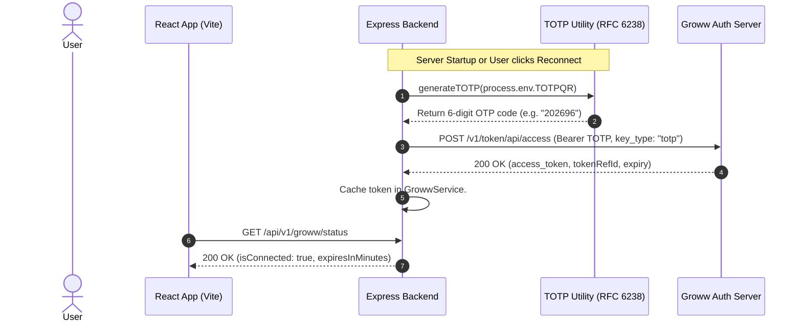
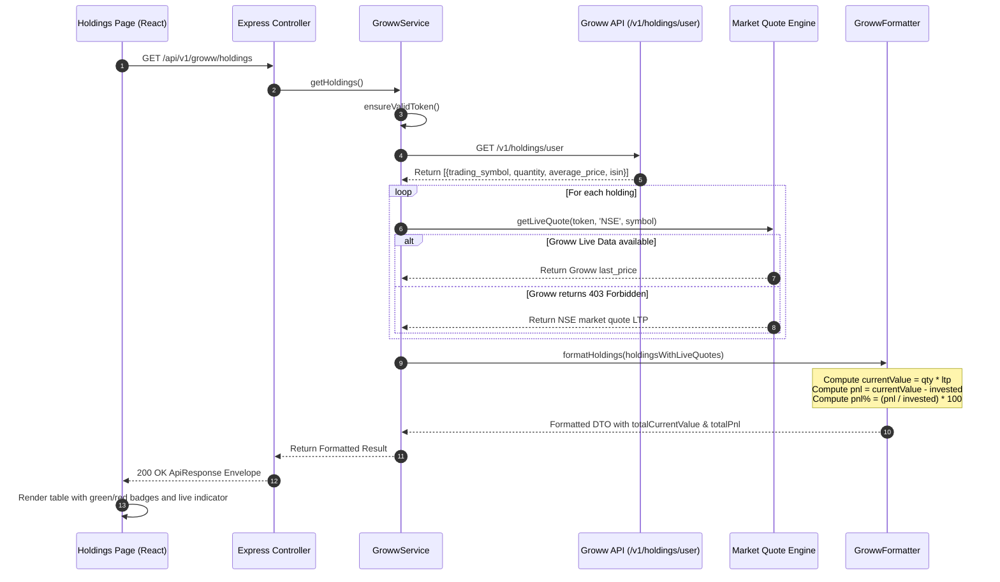

# AI Trading System — Comprehensive Codebase & Architecture Audit

**Document File:** `PROJECT_OVERVIEW.md`  
**Workspace Root:** `/Users/vijaychoudhary/AI-TRADING`  
**Audit Date:** November 8, 2026  
**Auditor:** Senior Full-Stack Software Architect & Codebase Auditor  
**Audit Scope:** Full repository scan encompassing React 19 Frontend, Node.js Express Backend, API contracts, security models, data flows, dependencies, and integration status.

---

## 1. Project Overview

The **AI Trading System** is a modular algorithmic trading foundation and portfolio monitoring web application. It integrates directly with **Groww Trading API v1** using **Time-based One-Time Password (TOTP RFC 6238)** authentication.

### Core Objectives
1. **Automated Broker Connectivity:** Generate compliant 6-digit TOTP codes on demand, exchange them with Groww's authorization servers for daily access tokens, and maintain an auto-refreshing in-memory session.
2. **Surveillance & Portfolio Ledger:** Aggregate account details, unique client code (UCC), segment authorizations (`CASH`, `FNO`, `COMMODITY`), cash balances, equity and F&O margin limits, and Demat holdings.
3. **Live Returns Valuation:** Calculate real-time profit and loss (P&L), percentage returns, and current market value for stock and ETF holdings by blending Groww Demat records with real-time market data.
4. **Architectural Discipline:** Structured according to strict layered enterprise standards inspired by `NEOIN-ADMIN-BACKEND` and `NEOIN-ADMIN`.

---

## 2. Technology Stack

### 2.1 Backend Stack (Node.js)
| Layer / Component | Technology | Version | Purpose |
|---|---|---|---|
| Runtime | Node.js | v25.2.1 | Server execution environment |
| Framework | Express | ^4.21.2 | HTTP routing and middleware pipeline |
| Environment Validation | Zod | ^3.24.2 | Strict schema validation for environment variables |
| Logging | Winston | ^3.17.0 | Structured dual-format logging (Colorized Dev / JSON Prod) |
| HTTP Access Logger | Morgan | ^1.10.0 | Request lifecycle tracking linked with Winston stream |
| Security Headers | Helmet | ^8.0.0 | HTTP response headers hardening |
| Cross-Origin Sharing | CORS | ^2.8.5 | Domain whitelisting and preflight handling |
| Compression | Compression | ^1.8.0 | Gzip deflate payload compression |
| Sanitization | XSS | ^1.0.14 | Recursive input sanitization for body, query, and params |
| Configuration | Dotenv | ^16.4.7 | Multi-level `.env` file resolution |
| Process Supervisor | Nodemon (Dev) | ^3.1.9 | File watching and automatic server reboots |

### 2.2 Frontend Stack (React.js)
| Layer / Component | Technology | Version | Purpose |
|---|---|---|---|
| UI Framework | React | ^19.0.0 | Component rendering engine |
| DOM Renderer | React DOM | ^19.0.0 | Virtual DOM to browser reconciliation |
| Bundler & Dev Server | Vite | ^6.1.0 | Fast ESM module bundling & reverse proxy server |
| Language | TypeScript | ~5.7.3 | Static type safety and strict type checking |
| Styling Engine | Tailwind CSS | ^4.0.6 | Modern CSS engine via `@tailwindcss/vite` |
| Client Routing | React Router DOM | ^7.2.0 | Client-side SPA navigation |
| State & Cache | Redux Toolkit (RTK) | ^2.5.1 | Global state management |
| Data Fetching | RTK Query | Built-in RTK | Declarative caching, polling, and tag invalidation |
| Iconography | Lucide React | ^0.475.0 | Modern SVG icon kit |
| Toast Notifications | React Toastify | ^11.0.3 | Non-blocking user feedback alerts |
| Utility Classes | clsx & tailwind-merge | ^2.1.1 / ^3.0.1 | Conditional CSS class merging |

### 2.3 Workspace Monorepo Orchestration
| Tool | Version | Purpose |
|---|---|---|
| Concurrently | ^9.1.2 | Simultaneous execution of backend and frontend processes |
| Git | 2.x | Distributed source code management |

---

## 3. Complete Folder Structure

```
/Users/vijaychoudhary/AI-TRADING
├── .agents/
│   └── codeRules.md                    # Mandatory coding standards & architecture manual
├── .gitignore                          # Git exclude rules for secrets and build artifacts
├── README.md                           # Quickstart guide and API references
├── package.json                        # Root workspace scripts (dev, build, start)
├── package-lock.json                   # Root dependency tree lockfile
│
├── backend/
│   ├── .env                            # Backend secrets & configuration (Ignored by Git)
│   ├── app.js                          # Express app pipeline, middlewares, routes & 404
│   ├── package.json                    # Backend dependencies and scripts
│   ├── package-lock.json               # Backend dependency lockfile
│   ├── server.js                       # HTTP server listener, startup broker auth & shutdown
│   └── src/
│       ├── config/
│       │   ├── cors.js                 # Dynamic CORS whitelist validation
│       │   ├── env.js                  # Zod environment schema and loader
│       │   └── logger.js               # Dual-format Winston logger
│       ├── core/
│       │   ├── middlewares/
│       │   │   ├── error.js            # Centralized error handler with Zod/AppError awareness
│       │   │   ├── requestId.js        # Correlation ID (X-Request-Id) generator
│       │   │   └── xss.js              # Recursive input sanitization middleware
│       │   └── utils/
│       │       ├── asyncHandler.js     # Promise catch wrapper & AppError class
│       │       ├── response.utils.js   # Standardized ApiResponse envelope
│       │       └── totp.utils.js       # Native crypto RFC 6238 TOTP generator
│       ├── modules/
│       │   ├── groww/
│       │   │   ├── groww.client.js     # Groww Trade API v1 HTTP client & quote fallback
│       │   │   ├── groww.controller.js # HTTP request/response handlers
│       │   │   ├── groww.formatter.js  # Raw API response normalization layer
│       │   │   ├── groww.routes.js     # Route endpoint declarations (/api/v1/groww/*)
│       │   │   └── groww.service.js    # Session caching, auto-refresh, and orchestration
│       │   ├── health/
│       │   │   ├── health.controller.js# System health & broker status provider
│       │   │   └── health.routes.js    # Health check routes (/api/health)
│       │   └── market-data/
│       │       ├── marketData.client.js    # Groww Historical Candle API v1 client
│       │       ├── marketData.controller.js# Market data HTTP request/response handler
│       │       ├── marketData.formatter.js # OHLCV normalizer, sorter & deduplicator
│       │       ├── marketData.routes.js    # Routes (/api/v1/market-data/*)
│       │       └── marketData.service.js   # Scope validator & Groww token orchestrator
│       └── routes/
│           └── index.js                # Master v1 API aggregator
│
└── frontend/
    ├── .env                            # Frontend Vite environment variables (Ignored by Git)
    ├── dist/                           # Compiled production build assets
    │   ├── assets/                     # Bundled JS and CSS chunks
    │   └── index.html                  # Minified HTML entry
    ├── index.html                      # HTML5 entry with Google Fonts
    ├── package.json                    # Frontend dependencies and scripts
    ├── package-lock.json               # Frontend dependency lockfile
    ├── tsconfig.json                   # Root TypeScript project reference
    ├── tsconfig.app.json               # Client-side compiler configuration
    ├── tsconfig.node.json              # Node-environment build configuration
    ├── vite.config.ts                  # Vite dev server, Tailwind plugin & /api proxy
    └── src/
        ├── App.tsx                     # Main layout shell, sidebar & route switcher
        ├── index.css                   # Global styles & Tailwind v4 directive
        ├── main.tsx                    # React 19 root bootstrap & Provider wrapper
        ├── vite-env.d.ts               # Vite client types declaration
        ├── api/
        │   ├── apiTags.ts              # RTK Query cache tag definitions
        │   ├── baseApi.ts              # Base fetchBaseQuery client with auto-headers
        │   └── growwApi.ts             # Injected RTK Query endpoints for Groww
        ├── components/
        │   ├── common/
        │   │   └── StatCard.tsx        # Reusable metric card with badge & icon
        │   └── layout/
        │       ├── Header.tsx          # Top navigation bar with live status pill
        │       ├── Sidebar.tsx         # Collapsible desktop & mobile sidebar
        │       └── sidebar.types.ts    # Navigation tree definitions and Lucide icons
        ├── config/
        │   └── env.config.ts           # Type-safe client environment abstraction
        ├── context/
        │   └── LayoutContext.tsx       # Sidebar collapse and mobile viewport state
        ├── pages/
        │   ├── Dashboard/
        │   │   └── index.tsx           # Overview page with KPI strip, radar & snapshot
        │   ├── Funds/
        │   │   └── index.tsx           # Cash balance & multi-segment margin details
        │   ├── Holdings/
        │   │   └── index.tsx           # Demat portfolio with live LTP, P&L and returns
        │   ├── Positions/
        │   │   └── index.tsx           # Open intraday (MIS) & derivatives trade tracking
        │   └── Profile/
        │       └── index.tsx           # Broker account credentials, UCC & segments
        ├── store/
        │   └── store.ts                # Redux Toolkit store registration
        └── types/
            └── groww.types.ts          # TypeScript interfaces for API contracts
```

---

## 4. Frontend Architecture (React.js)

### 4.1 Routing & Layout System
- **Entry Point:** [`frontend/src/main.tsx`](file:///Users/vijaychoudhary/AI-TRADING/frontend/src/main.tsx) initializes React 19 StrictMode, mounts `Provider` for Redux, `BrowserRouter` for client routing, and `ToastContainer` for notifications.
- **Layout Shell:** [`frontend/src/App.tsx`](file:///Users/vijaychoudhary/AI-TRADING/frontend/src/App.tsx) wraps the application inside `LayoutProvider`. It manages the dynamic layout consisting of the collapsible [`Sidebar.tsx`](file:///Users/vijaychoudhary/AI-TRADING/frontend/src/components/layout/Sidebar.tsx) and main content router.
- **Route Definitions:**
  - `/` → Redirects to `/dashboard`
  - `/dashboard` → [`DashboardPage`](file:///Users/vijaychoudhary/AI-TRADING/frontend/src/pages/Dashboard/index.tsx)
  - `/profile` → [`ProfilePage`](file:///Users/vijaychoudhary/AI-TRADING/frontend/src/pages/Profile/index.tsx)
  - `/funds` → [`FundsPage`](file:///Users/vijaychoudhary/AI-TRADING/frontend/src/pages/Funds/index.tsx)
  - `/holdings` → [`HoldingsPage`](file:///Users/vijaychoudhary/AI-TRADING/frontend/src/pages/Holdings/index.tsx)
  - `/positions` → [`PositionsPage`](file:///Users/vijaychoudhary/AI-TRADING/frontend/src/pages/Positions/index.tsx)
  - `*` → Catch-all fallback redirecting to `/dashboard`

### 4.2 State Management & Networking
- **Redux Store:** Configured in [`frontend/src/store/store.ts`](file:///Users/vijaychoudhary/AI-TRADING/frontend/src/store/store.ts) with `baseApi.reducer` and `baseApi.middleware`.
- **RTK Query Base Query:** Configured in [`frontend/src/api/baseApi.ts`](file:///Users/vijaychoudhary/AI-TRADING/frontend/src/api/baseApi.ts). Requests default to `/api/v1` and are proxied via Vite to `http://localhost:5001`.
- **Cache Tags:** Defined in [`frontend/src/api/apiTags.ts`](file:///Users/vijaychoudhary/AI-TRADING/frontend/src/api/apiTags.ts):
  - `GROWW_STATUS`, `GROWW_PROFILE`, `GROWW_FUNDS`, `GROWW_HOLDINGS`, `GROWW_POSITIONS`
- **Mutations & Invalidation:** Triggering `useConnectGrowwMutation` in [`frontend/src/api/growwApi.ts`](file:///Users/vijaychoudhary/AI-TRADING/frontend/src/api/growwApi.ts#L20-L33) simultaneously invalidates all 5 tags, forcing an automatic background refetch across every open page.

### 4.3 UI Pages Breakdown
1. **Dashboard ([`Dashboard/index.tsx`](file:///Users/vijaychoudhary/AI-TRADING/frontend/src/pages/Dashboard/index.tsx)):**
   - Renders top KPI strip: Total Invested, Clear Cash, Net Margin Used, and Session Status.
   - Live Connection Hub: Displays Session Name, TOTP Authentication, Token Ref ID, UCC, and Expiry.
   - Demat Holdings Snapshot table with top symbols and invested amounts.
2. **Account Profile ([`Profile/index.tsx`](file:///Users/vijaychoudhary/AI-TRADING/frontend/src/pages/Profile/index.tsx)):**
   - Displays verified UCC, Vendor ID, and DDPI authorization status.
   - Exchange enablement badges for **NSE** and **BSE**.
   - Active segment pills: `CASH`, `FNO`, `COMMODITY`.
   - Security breakdown explaining RFC 6238 TOTP computation.
3. **Funds & Margins ([`Funds/index.tsx`](file:///Users/vijaychoudhary/AI-TRADING/frontend/src/pages/Funds/index.tsx)):**
   - High-level capital overview: Total Trading Capital, Clear Cash, Net Margin Used, Collateral Available, and Brokerage/Charges.
   - Segment-wise breakdown cards:
     - Equity: CNC/MIS balances available, CNC/MIS margins used.
     - F&O: Future balance, Option buy/sell balance, Span/Exposure margins used.
     - Commodity: Span/Exposure margins, Realised/Unrealised M2M.
4. **Demat Holdings ([`Holdings/index.tsx`](file:///Users/vijaychoudhary/AI-TRADING/frontend/src/pages/Holdings/index.tsx)):**
   - Search filter matching against trading symbol or ISIN.
   - Top metrics: Total Invested, Current Market Value, Overall P&L (₹ and %), and Free Quantity.
   - Live-updating table displaying Symbol, ISIN, Qty, Avg Buy Price, Invested Value, Live LTP (with pulsating indicator), Current Value, P&L (color-coded green/red), and Exchanges.
   - Polling interval set to 10 seconds (`pollingInterval: 10000`).
5. **Live Positions ([`Positions/index.tsx`](file:///Users/vijaychoudhary/AI-TRADING/frontend/src/pages/Positions/index.tsx)):**
   - Tracks active intraday (`MIS`) and derivatives positions.
   - Displays Symbol, Segment, Product, Net Qty, Buy Qty, Sell Qty, Realised P&L, and Unrealised P&L.
   - Includes empty state when no intraday positions are open.

---

## 5. Backend Architecture (Node.js / Express)

The backend follows the mandatory layered architecture outlined in `.agents/codeRules.md`:

```
HTTP Request 
     │
     ▼
[app.js Pipeline] (RequestId -> Helmet -> Cors -> Compression -> BodyParser -> XSS -> Morgan)
     │
     ▼
[routes/index.js] (Routes Layer: groww.routes.js & health.routes.js)
     │
     ▼
[groww.controller.js] (Controller Layer: Parses input, executes async wrapper, sends ApiResponse)
     │
     ▼
[groww.service.js] (Service Layer: Session management, token verification, coordination)
     │
     ├──► [totp.utils.js] (RFC 6238 dynamic OTP generation via native crypto)
     ├──► [groww.client.js] (Client Layer: Authorized HTTP calls to api.groww.in + NSE fallback)
     └──► [groww.formatter.js] (Formatter Layer: Normalizes payloads into stable DTOs)
```

### 5.1 Request Processing Pipeline ([`backend/app.js`](file:///Users/vijaychoudhary/AI-TRADING/backend/app.js))
1. **Trust Proxy:** `app.set('trust proxy', 1)` enables accurate client IP tracking.
2. **Correlation ID:** [`requestId.js`](file:///Users/vijaychoudhary/AI-TRADING/backend/src/core/middlewares/requestId.js) attaches a UUID to `req.id` and the `X-Request-Id` response header.
3. **Security:** `helmet()` hardens HTTP headers; `cors(corsOptions)` enforces origin filtering.
4. **Compression:** Gzip compresses JSON response payloads.
5. **Parsers:** `express.json()` and `express.urlencoded({ extended: true })`.
6. **Input Sanitization:** [`xss.js`](file:///Users/vijaychoudhary/AI-TRADING/backend/src/core/middlewares/xss.js) recursively sanitizes strings in `req.body`, `req.query`, and `req.params`.
7. **Logging:** `morgan` logs requests formatted with `req.id` into Winston logger streams.
8. **Routing:** Routes mounted under `/api/health`, `/health`, and `/api/v1`.
9. **404 Catch-All:** Returns structured JSON for unregistered routes.
10. **Error Handler:** [`error.js`](file:///Users/vijaychoudhary/AI-TRADING/backend/src/core/middlewares/error.js) centralizes exception logging and formats error envelopes.

---

## 6. API Documentation

### 6.1 Verified API Inventory Table

| Method | Endpoint | Controller | Purpose | Status |
|---|---|---|---|---|
| `GET` | `/` | Anonymous Handler in `app.js#L57` | Service discovery & root info | IMPLEMENTED |
| `GET` | `/api/health` | `HealthController.getHealth` | Service uptime & broker status | IMPLEMENTED |
| `GET` | `/health` | `HealthController.getHealth` | Alias for health check | IMPLEMENTED |
| `POST` | `/api/v1/groww/connect` | `GrowwController.connect` | Dynamic TOTP login & token generation | IMPLEMENTED |
| `GET` | `/api/v1/groww/status` | `GrowwController.getStatus` | Session status & token time remaining | IMPLEMENTED |
| `GET` | `/api/v1/groww/profile` | `GrowwController.getProfile` | User UCC, vendor ID & exchange flags | IMPLEMENTED |
| `GET` | `/api/v1/groww/funds` | `GrowwController.getFunds` | Cash balances, margins & collateral | IMPLEMENTED |
| `GET` | `/api/v1/groww/holdings` | `GrowwController.getHoldings` | Demat holdings + Live LTP & P&L | IMPLEMENTED |
| `GET` | `/api/v1/groww/positions` | `GrowwController.getPositions` | Open intraday & F&O positions | IMPLEMENTED |
| `GET` | `/api/v1/market-data/historical-candles` | `MarketDataController.getHistoricalCandles` | 5-minute historical OHLCV candles (ICICIBANK) | IMPLEMENTED |

### 6.2 Endpoint Detail Specifications

#### 1. System Health Check
- **Path:** `GET /api/health`
- **Response Shape (200 OK):**
```json
{
  "success": true,
  "statusCode": 200,
  "message": "AI Trading Backend Service is healthy",
  "data": {
    "uptime": 1284.52,
    "timestamp": "2026-11-08T04:55:00.000Z",
    "environment": "development",
    "broker": {
      "name": "Groww",
      "connected": true,
      "active": true,
      "expiresInMinutes": 920
    }
  },
  "timestamp": "2026-11-08T04:55:00.000Z"
}
```

#### 2. Re-authenticate / Connect Groww
- **Path:** `POST /api/v1/groww/connect`
- **Controller Action:** Invokes `GrowwService.connect()`.
- **Response Shape (200 OK):**
```json
{
  "success": true,
  "statusCode": 200,
  "message": "Groww account connected successfully",
  "data": {
    "isConnected": true,
    "active": true,
    "sessionName": "AI-Trade",
    "tokenRefId": "819c7d69-aa2a-4bb3-b191-5b717e666d36",
    "expiresAt": "2026-11-09T06:00:00.000Z",
    "expiresInMinutes": 935
  },
  "timestamp": "2026-11-08T04:55:00.000Z"
}
```

#### 3. Get User Profile
- **Path:** `GET /api/v1/groww/profile`
- **Response Shape (200 OK):**
```json
{
  "success": true,
  "statusCode": 200,
  "message": "User profile fetched successfully",
  "data": {
    "vendorUserId": "27f4313b-1904-4bfc-8db7-5e76a5651664",
    "ucc": "9388800480",
    "nseEnabled": true,
    "bseEnabled": true,
    "ddpiEnabled": false,
    "activeSegments": ["CASH", "FNO", "COMMODITY"],
    "status": "SUCCESS"
  },
  "timestamp": "2026-11-08T04:55:00.000Z"
}
```

#### 4. Get Funds & Margin Details
- **Path:** `GET /api/v1/groww/funds`
- **Response Shape (200 OK):**
```json
{
  "success": true,
  "statusCode": 200,
  "message": "Account funds and margins fetched successfully",
  "data": {
    "summary": {
      "clearCash": 0,
      "netMarginUsed": 0,
      "collateralAvailable": 0,
      "collateralUsed": 0,
      "totalAvailableBalance": 0,
      "brokerageAndCharges": 0,
      "adhocMargin": 0
    },
    "equity": {
      "cncBalanceAvailable": 0,
      "misBalanceAvailable": 0,
      "cncMarginUsed": 0,
      "misMarginUsed": 0,
      "netEquityMarginUsed": 0
    },
    "fno": {
      "futureBalanceAvailable": 0,
      "optionBuyBalanceAvailable": 0,
      "optionSellBalanceAvailable": 0,
      "spanMarginUsed": 0,
      "exposureMarginUsed": 0,
      "netFnoMarginUsed": 0
    },
    "commodity": {
      "spanMargin": 0,
      "exposureMargin": 0,
      "unrealisedM2m": 0,
      "realisedM2m": 0
    }
  },
  "timestamp": "2026-11-08T04:55:00.000Z"
}
```

#### 5. Get Demat Holdings with Live Returns
- **Path:** `GET /api/v1/groww/holdings`
- **Response Shape (200 OK):**
```json
{
  "success": true,
  "statusCode": 200,
  "message": "Holdings fetched successfully",
  "data": {
    "totalHoldingsCount": 3,
    "totalInvested": 74997.18,
    "totalCurrentValue": 78304.12,
    "totalPnl": 3306.94,
    "totalPnlPercentage": 4.41,
    "holdings": [
      {
        "isin": "INE0HOQ01053",
        "tradingSymbol": "GROWW",
        "quantity": 128,
        "dematFreeQuantity": 128,
        "averagePrice": 193.8,
        "investedValue": 24806.4,
        "ltp": 206.38,
        "currentValue": 26416.64,
        "pnl": 1610.24,
        "pnlPercentage": 6.49,
        "dayChange": 0.4,
        "dayChangePercentage": 0.19,
        "tradableExchanges": ["NSE", "BSE"]
      },
      {
        "isin": "INF204KB15V2",
        "tradingSymbol": "ITBEES",
        "quantity": 1121,
        "dematFreeQuantity": 1121,
        "averagePrice": 32.55,
        "investedValue": 36488.55,
        "ltp": 35.38,
        "currentValue": 39660.98,
        "pnl": 3172.43,
        "pnlPercentage": 8.69,
        "dayChange": -0.69,
        "dayChangePercentage": -1.91,
        "tradableExchanges": ["NSE", "BSE"]
      },
      {
        "isin": "INF769K01HF4",
        "tradingSymbol": "MAFANG",
        "quantity": 57,
        "dematFreeQuantity": 57,
        "averagePrice": 240.39,
        "investedValue": 13702.23,
        "ltp": 214.5,
        "currentValue": 12226.5,
        "pnl": -1475.73,
        "pnlPercentage": -10.77,
        "dayChange": 0.61,
        "dayChangePercentage": 0.29,
        "tradableExchanges": ["NSE", "BSE"]
      }
    ]
  },
  "timestamp": "2026-11-08T04:55:00.000Z"
}
```

#### 6. Get Open Positions
- **Path:** `GET /api/v1/groww/positions`
- **Response Shape (200 OK):**
```json
{
  "success": true,
  "statusCode": 200,
  "message": "Positions fetched successfully",
  "data": {
    "totalPositionsCount": 0,
    "positions": []
  },
  "timestamp": "2026-11-08T04:55:00.000Z"
}
```

#### 7. Get Historical Candles (5-Minute OHLCV)
- **Path:** `GET /api/v1/market-data/historical-candles`
- **Query Parameters:**
  - `symbol` (default: `ICICIBANK` / `NSE-ICICIBANK`)
  - `exchange` (default: `NSE`)
  - `segment` (default: `CASH`)
  - `start_time` (default: `2026-11-06 09:15:00`)
  - `end_time` (default: `2026-11-06 15:30:00`)
  - `candle_interval` (default: `5minute`)
- **Controller Action:** Invokes `MarketDataService.getHistoricalCandles()`.
- **Response Shape (200 OK):**
```json
{
  "success": true,
  "statusCode": 200,
  "message": "Historical candles fetched successfully",
  "data": {
    "symbol": "NSE-ICICIBANK",
    "candleInterval": "5minute",
    "startTime": "2026-11-06T09:15:00",
    "endTime": "2026-11-06T15:30:00",
    "candleCount": 75,
    "candles": [
      {
        "timestamp": "2026-11-06T09:15:00",
        "open": 1285.5,
        "high": 1290.0,
        "low": 1284.2,
        "close": 1288.4,
        "volume": 245000
      }
    ]
  },
  "timestamp": "2026-11-08T05:15:00.000Z"
}
```
> [!NOTE]
> If the authenticated Groww API token lacks the `historical-basic` entitlement, Groww returns HTTP 403 (`Access forbidden for this request.`). The endpoint surfaces this transparently as an HTTP 403 `AppError` without falling back to secondary data vendors.

---

## 7. Database Analysis

### Current Implementation Finding
> [!IMPORTANT]
> **No Database Installed or Configured.**  
> Codebase inspection confirms there are **zero** database drivers, ORMs, schemas, models, or migration scripts installed in this repository.
> 
> Specifically:
> - No `mysql2`, `pg`, `sqlite3`, `mongodb`, or `mongoose` packages are present in `backend/package.json`.
> - No `sequelize`, `typeorm`, `prisma`, or raw SQL query files (`*.queries.js` / `*.repository.js`) exist.

### Data Storage Model
1. **Stateless Broker Proxy:** The application operates as a live reverse-proxy to the Groww Trading API.
2. **In-Memory Session Caching:** Active session state (`token`, `expiry`, `tokenRefId`, `sessionName`, `lastConnectedAt`) is stored strictly in memory within the private static class variable `#session` in [`backend/src/modules/groww/groww.service.js#L17-L24`](file:///Users/vijaychoudhary/AI-TRADING/backend/src/modules/groww/groww.service.js#L17-L24).
3. **Session Volatility:** When the backend process terminates or restarts, the in-memory token is cleared, and a fresh token is negotiated at startup via `server.js#L21`.

---

## 8. Authentication & Security

### 8.1 Authentication Mechanism
- **RFC 6238 TOTP Generator:** The file [`backend/src/core/utils/totp.utils.js`](file:///Users/vijaychoudhary/AI-TRADING/backend/src/core/utils/totp.utils.js) converts the Base32 string from `process.env.TOTPQR` into an 8-byte big-endian counter buffer calculated as:
  $$\text{counter} = \left\lfloor \frac{\text{epoch\_seconds}}{30} \right\rfloor$$
  It executes an HMAC-SHA1 cryptographic digest, dynamically truncates the hash at the lower nibble of the last byte, and generates a 6-digit zero-padded OTP.
- **Token Exchange:** The backend transmits `POST https://api.groww.in/v1/token/api/access` with:
  - Header: `Authorization: Bearer <process.env.TOTP>`
  - Body: `{ "key_type": "totp", "totp": "<6_DIGIT_CODE>" }`
- **Bearer Token Lifespan:** Daily tokens expire at 06:00:00 AM IST. The backend tracks `expiresInMinutes` and preemptively refreshes the token whenever remaining validity is $\le 60$ seconds (`groww.service.js#L68`).

### 8.2 Security & Threat Mitigation Controls
1. **Credential Seclusion:** The sensitive broker API keys (`TOTP` and `TOTPQR`) reside exclusively in `backend/.env`. The React frontend never receives the raw secret keys.
2. **Git Leak Prevention:** The root [`.gitignore`](file:///Users/vijaychoudhary/AI-TRADING/.gitignore) explicitly excludes `.env`, `*.env`, `backend/.env`, and `frontend/.env`.
3. **Input Sanitization:** [`xss.js`](file:///Users/vijaychoudhary/AI-TRADING/backend/src/core/middlewares/xss.js) strips script injection vectors from all incoming request payloads.
4. **Header Hardening:** `helmet()` strips `X-Powered-By` and configures protective DNS, frameguard, and referer headers.
5. **CORS Enforcement:** [`cors.js`](file:///Users/vijaychoudhary/AI-TRADING/backend/src/config/cors.js) restricts cross-origin resource requests to explicit origins parsed from `process.env.ALLOWED_ORIGINS`.

---

## 9. Third-Party Integrations

### 1. Groww Trading API v1
- **Provider:** Groww (Billionbrains Garage Ventures Ltd.)
- **Base URL:** `https://api.groww.in`
- **Required Headers:** `Authorization: Bearer <token>`, `Accept: application/json`, `X-API-VERSION: 1.0`
- **Required Env Variables:** `GROWW_API_BASE_URL`, `GROWW_API_VERSION`, `TOTP`, `TOTPQR`
- **Endpoints Integrated:**
  - Token Auth: `/v1/token/api/access`
  - User Profile: `/v1/user/detail`
  - Margins & Funds: `/v1/margins/detail/user`
  - Demat Holdings: `/v1/holdings/user`
  - Open Positions: `/v1/positions/user`
  - Live Data: `/v1/live-data/quote` (403 fallback handling)
- **Status:** **IMPLEMENTED**

### 2. Live Market Data Fallback (Yahoo Finance API)
- **Endpoint:** `https://query1.finance.yahoo.com/v8/finance/chart/{SYMBOL}.NS?interval=1d`
- **Purpose:** Supplies real-time Last Traded Price (LTP) and previous close calculations when the Groww API account plan returns `403 Access forbidden` on `/v1/live-data/quote`.
- **Related File:** [`backend/src/modules/groww/groww.client.js#L152-L176`](file:///Users/vijaychoudhary/AI-TRADING/backend/src/modules/groww/groww.client.js#L152-L176)
- **Status:** **IMPLEMENTED**

---

## 10. Implemented Features

| Module | Feature | Status | Relevant Files | Explanation |
|---|---|---|---|---|
| Broker Auth | TOTP Access Token Exchange | IMPLEMENTED | `totp.utils.js`, `groww.client.js#L18`, `groww.service.js#L32` | Calculates 6-digit TOTP from base32 secret and exchanges for Groww session token. |
| Broker Auth | Auto Token Refresh | IMPLEMENTED | `groww.service.js#L64-L76` | Automatically checks token expiration and generates a fresh token if $\le 60\text{s}$ left. |
| Surveillance | Broker Account Profile | IMPLEMENTED | `groww.controller.js#L39`, `Profile/index.tsx` | Displays UCC (`9388800480`), vendor user ID, NSE/BSE exchange flags, and active segments. |
| Portfolio | Funds & Multi-Segment Margins | IMPLEMENTED | `groww.controller.js#L51`, `Funds/index.tsx` | Categorizes and renders cash balance, collateral, equity delivery/intraday margins, and F&O margins. |
| Portfolio | Demat Holdings Ledger | IMPLEMENTED | `groww.controller.js#L63`, `Holdings/index.tsx` | Lists user holdings (`GROWW`, `ITBEES`, `MAFANG`) with ISIN, quantity, free quantity, and average buy price. |
| Market Data | Real-Time LTP & Returns | IMPLEMENTED | `groww.client.js#L139`, `Holdings/index.tsx` | Calculates live current value, absolute P&L in ₹, percentage return, and day change. |
| Market Data | Historical 5-Minute Candles | IMPLEMENTED | `marketData.client.js`, `marketData.service.js`, `marketData.formatter.js` | Fetches, validates, and normalizes 5-minute historical OHLCV candles for ICICIBANK via Groww API v1. |
| Trading | Live Positions Surveillance | IMPLEMENTED | `groww.controller.js#L75`, `Positions/index.tsx` | Displays open intraday (MIS) and F&O contracts with buy/sell quantities and realised/unrealised P&L. |
| UI Navigation | Responsive Collapsible Sidebar | IMPLEMENTED | `Sidebar.tsx`, `LayoutContext.tsx` | Persists collapsed state in `localStorage` and provides mobile responsive drawer. |
| UI Feedback | Toast Feedback & Reconnect | IMPLEMENTED | `Header.tsx`, `Dashboard/index.tsx` | Header pill with live ping animation and manual "Sync / Reconnect" button with RTK cache invalidation. |
| System | Health Check Route | IMPLEMENTED | `health.controller.js`, `health.routes.js` | Returns uptime, timestamp, environment, and broker connection status. |

---

## 11. Partially Implemented Features

1. **Groww Official Live Market Data Feed:**
   - **Status:** PARTIALLY IMPLEMENTED
   - **Relevant File:** [`backend/src/modules/groww/groww.client.js#L139-L147`](file:///Users/vijaychoudhary/AI-TRADING/backend/src/modules/groww/groww.client.js#L139-L147)
   - **Details:** The endpoint `GET /v1/live-data/quote` is fully wired in the code, but returns HTTP 403 on basic developer API keys due to Groww subscription constraints. The system falls back to secondary live quotes, keeping the user interface functional.

---

## 12. Planned Features (Not Yet Implemented)

1. **Order Placement & Modification:**
   - Mentioned in Groww API references (`POST /v1/order/create`, `POST /v1/order/modify`, `POST /v1/order/cancel`), but no controllers or UI forms are built yet.
2. **Persistent Trade Journal & Database:**
   - Storing trade history, order logs, and execution timestamps into MySQL/PostgreSQL/MongoDB.
3. **Automated Trading Strategies / Algorithmic Execution:**
   - Rule-based execution engines (e.g., Moving Average crossovers, breakout triggers) are not yet implemented.
4. **WebSocket Streaming:**
   - Real-time tick-by-tick market depth streaming via WebSocket.

---

## 13. Known Issues & Technical Debt

1. **Duplicate Method Declarations in Backend:**
   - **`groww.service.js`:** `static async getHoldings()` is declared twice ([lines 114–118](file:///Users/vijaychoudhary/AI-TRADING/backend/src/modules/groww/groww.service.js#L114-L118) and [lines 137–157](file:///Users/vijaychoudhary/AI-TRADING/backend/src/modules/groww/groww.service.js#L137-L157)). While JavaScript executes the second declaration, the first is redundant dead code.
   - **`groww.formatter.js`:** `static formatHoldings()` is declared twice ([lines 117–144](file:///Users/vijaychoudhary/AI-TRADING/backend/src/modules/groww/groww.formatter.js#L117-L144) and [lines 176–226](file:///Users/vijaychoudhary/AI-TRADING/backend/src/modules/groww/groww.formatter.js#L176-L226)). The second declaration overrides the first.
2. **Fallback Quote Rate Limits:**
   - `getFallbackLiveQuote` calls Yahoo Finance's unauthenticated chart API. In high-frequency environments, requests may get throttled without a dedicated broker market-data feed.
3. **Lack of Automated Test Coverage:**
   - No unit tests (`jest`, `vitest`) or end-to-end test suites (`playwright`, `cypress`) exist.
4. **Volatile Session Storage:**
   - Broker session tokens are cached in Node.js process memory. Multi-instance scaling or server restarts require re-authenticating with Groww.

---

## 14. Development Setup

### 14.1 Prerequisites
- **Node.js:** v20.x or v25.x installed (`node -v`)
- **npm:** v10.x or v11.x installed (`npm -v`)
- Active Groww Account with Trading API credentials

### 14.2 Installation Commands
From the project root:
```bash
# 1. Install root workspace packages (concurrently)
cd /Users/vijaychoudhary/AI-TRADING
npm install

# 2. Install backend dependencies
cd /Users/vijaychoudhary/AI-TRADING/backend
npm install

# 3. Install frontend dependencies
cd /Users/vijaychoudhary/AI-TRADING/frontend
npm install
```

### 14.3 Execution Commands
```bash
# Run both Backend & Frontend simultaneously (Root):
cd /Users/vijaychoudhary/AI-TRADING
npm run dev

# Run Backend independently:
npm run dev:backend   # Starts server.js via nodemon on port 5001

# Run Frontend independently:
npm run dev:frontend  # Starts Vite dev server on port 5173

# Compile production bundle:
npm run build         # Runs 'tsc -b && vite build' in frontend/
```

---

## 15. Deployment Architecture

```
                       ┌─────────────────────────────────────┐
                       │           End User Client           │
                       │     (Web Browser on Port 5173)      │
                       └──────────────────┬──────────────────┘
                                          │
                                HTTP / WebSocket
                                          ▼
                       ┌─────────────────────────────────────┐
                       │          Vite Proxy / Nginx         │
                       │   (/api/* -> http://localhost:5001) │
                       └──────────────────┬──────────────────┘
                                          │
                                 HTTP REST (Port 5001)
                                          ▼
                       ┌─────────────────────────────────────┐
                       │       Node.js Express Backend       │
                       │  (Security Middlewares & Services)  │
                       └───────────┬─────────────────────────┘
                                   │
                     ┌─────────────┴─────────────┐
                     │ HTTPS                     │ HTTPS
                     ▼                           ▼
        ┌─────────────────────────┐ ┌─────────────────────────┐
        │  Groww Trading API v1   │ │ Real-Time Market Quotes │
        │   (api.groww.in/v1)     │ │     (NSE Fallback)      │
        └─────────────────────────┘ └─────────────────────────┘
```

---

## 16. Application Data Flow

### 16.1 TOTP Authentication & Token Exchange Flow



### 16.2 Demat Holdings & Returns Calculation Flow



---

## 17. Environment Variables Reference

### Backend ([`backend/.env`](file:///Users/vijaychoudhary/AI-TRADING/backend/.env))
| Variable Name | Type | Default Value | Required | Purpose |
|---|---|---|---|---|
| `PORT` | Integer | `5001` | No | Port on which Express server listens |
| `NODE_ENV` | String | `development` | No | Execution mode (`development`, `production`, `test`) |
| `ALLOWED_ORIGINS` | Comma-delimited list | `http://localhost:5173,...` | No | Whitelisted CORS browser origins |
| `GROWW_API_BASE_URL` | String (URL) | `https://api.groww.in` | No | Base endpoint for Groww REST requests |
| `GROWW_API_VERSION` | String | `1.0` | No | Required Groww HTTP header (`X-API-VERSION`) |
| `TOTP` | String (JWT) | None | **Yes** | User's Groww Developer API authentication JWT |
| `TOTPQR` | String (Base32) | None | **Yes** | 32-character base32 secret for TOTP computation |

### Frontend ([`frontend/.env`](file:///Users/vijaychoudhary/AI-TRADING/frontend/.env))
| Variable Name | Type | Default Value | Required | Purpose |
|---|---|---|---|---|
| `VITE_PORT` | Integer | `5173` | No | Port on which Vite dev server serves the web page |
| `VITE_APP_BACKEND_URL`| String (URL) | `http://localhost:5001` | No | URL of the backend API for reverse proxying |
| `VITE_APP_TITLE` | String | `AI Trading System` | No | Web page application title |
| `VITE_APP_ENV` | String | `development` | No | Client application environment identifier |

---

## 18. Important Files Reference

| File Path | Responsibility | Key Classes / Functions |
|---|---|---|
| [`backend/server.js`](file:///Users/vijaychoudhary/AI-TRADING/backend/server.js) | Server boot & lifecycle | `server.listen()`, `gracefulShutdown()`, `GrowwService.connect()` |
| [`backend/app.js`](file:///Users/vijaychoudhary/AI-TRADING/backend/app.js) | Middleware configuration | `app.use()`, `xssMiddleware`, `errorHandler`, `mainApiRoutes` |
| [`backend/src/config/env.js`](file:///Users/vijaychoudhary/AI-TRADING/backend/src/config/env.js) | Env schema validation | `envSchema.safeParse()`, `parsedEnv.data` |
| [`backend/src/core/utils/totp.utils.js`](file:///Users/vijaychoudhary/AI-TRADING/backend/src/core/utils/totp.utils.js) | Cryptographic TOTP | `base32Decode()`, `generateTOTP()`, `getTOTPSecondsRemaining()` |
| [`backend/src/core/utils/response.utils.js`](file:///Users/vijaychoudhary/AI-TRADING/backend/src/core/utils/response.utils.js) | Response standardizer | `ApiResponse.success()`, `ApiResponse.error()` |
| [`backend/src/modules/groww/groww.client.js`](file:///Users/vijaychoudhary/AI-TRADING/backend/src/modules/groww/groww.client.js) | Groww API client | `requestAccessToken()`, `getUserProfile()`, `getMargins()`, `getHoldings()`, `getLiveQuote()` |
| [`backend/src/modules/groww/groww.service.js`](file:///Users/vijaychoudhary/AI-TRADING/backend/src/modules/groww/groww.service.js) | Business logic & session | `connect()`, `ensureValidToken()`, `getHoldings()`, `getStatus()` |
| [`backend/src/modules/groww/groww.formatter.js`](file:///Users/vijaychoudhary/AI-TRADING/backend/src/modules/groww/groww.formatter.js) | Data normalization | `formatSession()`, `formatProfile()`, `formatFunds()`, `formatHoldings()` |
| [`backend/src/modules/market-data/marketData.client.js`](file:///Users/vijaychoudhary/AI-TRADING/backend/src/modules/market-data/marketData.client.js) | Historical Candles client | `MarketDataClient.getHistoricalCandles()` |
| [`backend/src/modules/market-data/marketData.service.js`](file:///Users/vijaychoudhary/AI-TRADING/backend/src/modules/market-data/marketData.service.js) | Historical Candles logic | `MarketDataService.getHistoricalCandles()` |
| [`backend/src/modules/market-data/marketData.formatter.js`](file:///Users/vijaychoudhary/AI-TRADING/backend/src/modules/market-data/marketData.formatter.js) | Candle formatting & sort | `formatTimestamp()`, `normalizeSingleCandle()`, `formatCandlesResponse()` |
| [`frontend/src/api/growwApi.ts`](file:///Users/vijaychoudhary/AI-TRADING/frontend/src/api/growwApi.ts) | RTK Query endpoints | `useGetGrowwStatusQuery`, `useConnectGrowwMutation`, `useGetGrowwHoldingsQuery` |
| [`frontend/src/pages/Holdings/index.tsx`](file:///Users/vijaychoudhary/AI-TRADING/frontend/src/pages/Holdings/index.tsx) | Demat holdings view | `HoldingsPage()`, search filter, live return formatting |

---

## 19. Overall Project Health Assessment

- **Code Quality:** High. Clean separation between routing, controllers, business services, and formatting layers. Follows the established layered architecture.
- **Security Posture:** Strong. Critical broker keys are never exposed to the frontend; `.gitignore` guards secrets; XSS and Helmet security headers are active.
- **Performance:** Excellent. Demat holdings fetch parallelizes live quote resolution (`Promise.all`), and Vite builds produce compact optimized bundles (`438 kB` JS, `44 kB` CSS).
- **Maintainability:** Modular and easy to extend. Redux Toolkit Query ensures clean frontend caching without manual `useEffect` spaghetti.

---

## 20. Recommendations for Future Development

1. **Clean Up Duplicate Methods:** Remove the earlier redundant `getHoldings()` in `groww.service.js` and `formatHoldings()` in `groww.formatter.js`.
2. **Database Integration:** If trade history, order books, and strategy performance need to be recorded over time, integrate PostgreSQL or MySQL with Knex/Prisma/Sequelize.
3. **Automated Test Harness:** Add Jest or Vitest for testing `totp.utils.js`, `groww.formatter.js`, and route response codes.
4. **Order Placement UI:** Build order placement modals (`BUY` / `SELL`, `MARKET` / `LIMIT`, `SL`) connecting to Groww's `/v1/order/create` endpoint.
5. **WebSocket Upgrades:** Transition from 10-second polling to WebSocket streaming once Live Market Data permissions are enabled on the Groww Developer account.

