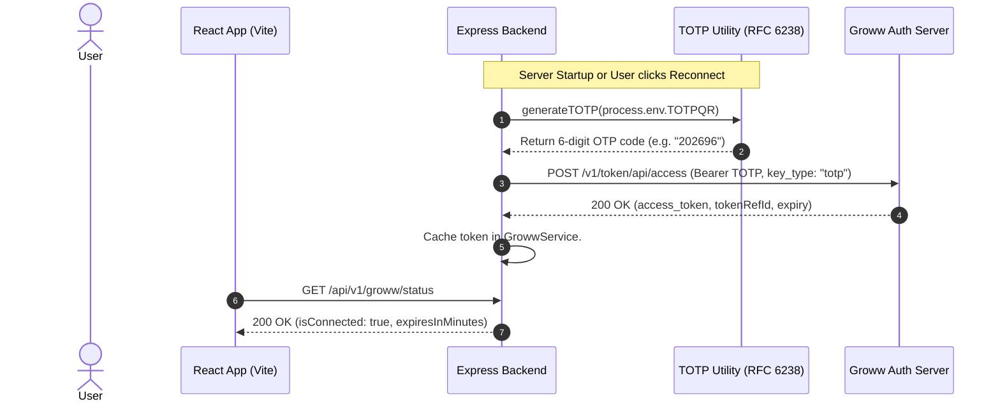
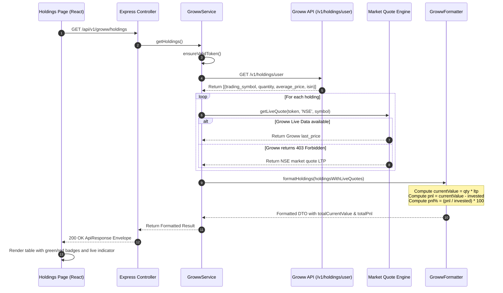

# AI Trading System — Comprehensive Codebase & Architecture Audit

**Document File:** `PROJECT_OVERVIEW.md`  
**Workspace Root:** `/Users/vijaychoudhary/AI-TRADING`  
**Audit Date:** November 8, 2026  
**Auditor:** Senior Full-Stack Software Architect & Codebase Auditor  
**Audit Scope:** Full repository scan encompassing React 19 Frontend, Node.js Express Backend, API contracts, security models, data flows, dependencies, and integration status.

---

## 1. Project Overview

The **AI Trading System** is a modular algorithmic trading foundation and portfolio monitoring web application. It integrates directly with **Groww Trading API v1** using **Time-based One-Time Password (TOTP RFC 6238)** authentication.

### Core Objectives
1. **Automated Broker Connectivity:** Generate compliant 6-digit TOTP codes on demand, exchange them with Groww's authorization servers for daily access tokens, and maintain an auto-refreshing in-memory session.
2. **Surveillance & Portfolio Ledger:** Aggregate account details, unique client code (UCC), segment authorizations (`CASH`, `FNO`, `COMMODITY`), cash balances, equity and F&O margin limits, and Demat holdings.
3. **Live Returns Valuation:** Calculate real-time profit and loss (P&L), percentage returns, and current market value for stock and ETF holdings by blending Groww Demat records with real-time market data.
4. **Architectural Discipline:** Structured according to strict layered enterprise standards inspired by `NEOIN-ADMIN-BACKEND` and `NEOIN-ADMIN`.

---

## 2. Technology Stack

### 2.1 Backend Stack (Node.js)
| Layer / Component | Technology | Version | Purpose |
|---|---|---|---|
| Runtime | Node.js | v25.2.1 | Server execution environment |
| Framework | Express | ^4.21.2 | HTTP routing and middleware pipeline |
| Environment Validation | Zod | ^3.24.2 | Strict schema validation for environment variables |
| Logging | Winston | ^3.17.0 | Structured dual-format logging (Colorized Dev / JSON Prod) |
| HTTP Access Logger | Morgan | ^1.10.0 | Request lifecycle tracking linked with Winston stream |
| Security Headers | Helmet | ^8.0.0 | HTTP response headers hardening |
| Cross-Origin Sharing | CORS | ^2.8.5 | Domain whitelisting and preflight handling |
| Compression | Compression | ^1.8.0 | Gzip deflate payload compression |
| Sanitization | XSS | ^1.0.14 | Recursive input sanitization for body, query, and params |
| Configuration | Dotenv | ^16.4.7 | Multi-level `.env` file resolution |
| Process Supervisor | Nodemon (Dev) | ^3.1.9 | File watching and automatic server reboots |

### 2.2 Frontend Stack (React.js)
| Layer / Component | Technology | Version | Purpose |
|---|---|---|---|
| UI Framework | React | ^19.0.0 | Component rendering engine |
| DOM Renderer | React DOM | ^19.0.0 | Virtual DOM to browser reconciliation |
| Bundler & Dev Server | Vite | ^6.1.0 | Fast ESM module bundling & reverse proxy server |
| Language | TypeScript | ~5.7.3 | Static type safety and strict type checking |
| Styling Engine | Tailwind CSS | ^4.0.6 | Modern CSS engine via `@tailwindcss/vite` |
| Client Routing | React Router DOM | ^7.2.0 | Client-side SPA navigation |
| State & Cache | Redux Toolkit (RTK) | ^2.5.1 | Global state management |
| Data Fetching | RTK Query | Built-in RTK | Declarative caching, polling, and tag invalidation |
| Iconography | Lucide React | ^0.475.0 | Modern SVG icon kit |
| Toast Notifications | React Toastify | ^11.0.3 | Non-blocking user feedback alerts |
| Utility Classes | clsx & tailwind-merge | ^2.1.1 / ^3.0.1 | Conditional CSS class merging |

### 2.3 Workspace Monorepo Orchestration
| Tool | Version | Purpose |
|---|---|---|
| Concurrently | ^9.1.2 | Simultaneous execution of backend and frontend processes |
| Git | 2.x | Distributed source code management |

---

## 3. Complete Folder Structure

```
/Users/vijaychoudhary/AI-TRADING
├── .agents/
│   └── codeRules.md                    # Mandatory coding standards & architecture manual
├── .gitignore                          # Git exclude rules for secrets and build artifacts
├── README.md                           # Quickstart guide and API references
├── package.json                        # Root workspace scripts (dev, build, start)
├── package-lock.json                   # Root dependency tree lockfile
│
├── backend/
│   ├── .env                            # Backend secrets & configuration (Ignored by Git)
│   ├── app.js                          # Express app pipeline, middlewares, routes & 404
│   ├── package.json                    # Backend dependencies and scripts
│   ├── package-lock.json               # Backend dependency lockfile
│   ├── server.js                       # HTTP server listener, startup broker auth & shutdown
│   ├── storage/
│   │   ├── derived/
│   │   │   └── indicators/             # Derived indicator CSVs (479,982 rows), summary & report
│   │   │       ├── INDICATOR_ENGINE_REPORT.md
│   │   │       ├── indicator_summary.json
│   │   │       ├── AXISBANK/           # AXISBANK derived indicator CSVs (2021-2026)
│   │   │       ├── BHARTIARTL/         # BHARTIARTL derived indicator CSVs (2021-2026)
│   │   │       ├── HDFCBANK/           # HDFCBANK derived indicator CSVs (2021-2026)
│   │   │       ├── ICICIBANK/          # ICICIBANK derived indicator CSVs (2021-2026)
│   │   │       └── M&M/                # M&M derived indicator CSVs (2021-2026)
│   │   ├── historical-data/            # 5-year 5-minute OHLCV CSV archives (479,982 candles)
│   │   │   ├── .checkpoint.json        # Resumable download checkpoint index
│   │   │   ├── download_summary.json   # Download audit & data integrity report
│   │   │   ├── DATA_QUALITY_AUDIT.md   # Part A certified session calendar & audit report
│   │   │   ├── AXISBANK/               # AXISBANK monthly CSVs (2021-2026)
│   │   │   ├── BHARTIARTL/             # BHARTIARTL monthly CSVs (2021-2026)
│   │   │   ├── HDFCBANK/               # HDFCBANK monthly CSVs (2021-2026)
│   │   │   ├── ICICIBANK/              # ICICIBANK monthly CSVs (2021-2026)
│   │   │   └── M&M/                    # M&M monthly CSVs (2021-2026)
│   │   ├── strategy/                   # Strategy specification, configurations & parameter matrix
│   │   │   ├── STRATEGY_CONFIGURATIONS.json # Validated core strategy variant presets (A through E)
│   │   │   ├── STRATEGY_PARAMETER_MATRIX.md # Orthogonal research cohorts for backtesting
│   │   │   └── STRATEGY_SPECIFICATION.md    # Master quantitative trading strategy specification
│   │   └── backtesting/                # Historical backtesting engine runs, journals & master reports
│   │       ├── BACKTEST_ENGINE_REPORT.md    # Master quantitative report across 25 batch runs
│   │       ├── runs_index.json              # Master registry catalog of all completed backtest runs
│   │       └── runs/                        # Partitioned run outputs (trades.csv, equity_curve.csv, summary.json)
│   ├── test/
│   │   ├── backtesting.test.js         # Native Node.js test suite for backtest engine & Groww fees (13 tests)
│   │   ├── indicators.test.js          # Native Node.js test suite for indicators (21 tests)
│   │   └── strategy.test.js            # Native Node.js test suite for strategy & risk (23 tests)
│   └── src/
│       ├── config/
│       │   ├── cors.js                 # Dynamic CORS whitelist validation
│       │   ├── env.js                  # Zod environment schema and loader
│       │   └── logger.js               # Dual-format Winston logger
│       ├── core/
│       │   ├── middlewares/
│       │   │   ├── error.js            # Centralized error handler with Zod/AppError awareness
│       │   │   ├── requestId.js        # Correlation ID (X-Request-Id) generator
│       │   │   └── xss.js              # Recursive input sanitization middleware
│       │   └── utils/
│       │       ├── asyncHandler.js     # Promise catch wrapper & AppError class
│       │       ├── response.utils.js   # Standardized ApiResponse envelope
│       │       └── totp.utils.js       # Native crypto RFC 6238 TOTP generator
│       ├── modules/
│       │   ├── backtesting/
│       │   │   ├── backtesting.constants.js # Fee schedules, default parameters, enums & directories
│       │   │   ├── backtesting.controller.js# HTTP controller for backtesting runs and trade journals
│       │   │   ├── backtesting.engine.js    # Event-driven backtester core loop & candle processor
│       │   │   ├── backtesting.execution.js # Fill simulation, slippage, same-bar ambiguity & exits
│       │   │   ├── backtesting.fees.js      # Groww transaction cost & statutory tax calculator
│       │   │   ├── backtesting.metrics.js   # Performance metrics (Gross/Net P&L, Sharpe, DD, streaks)
│       │   │   ├── backtesting.risk.js      # Position sizing delegation, circuit breakers & capital bounds
│       │   │   ├── backtesting.routes.js    # Routes (/api/v1/backtesting/*)
│       │   │   ├── backtesting.schema.js    # Zod schemas for backtesting request payloads
│       │   │   ├── backtesting.service.js   # Run orchestrator, batch evaluation & catalog queries
│       │   │   └── backtesting.storage.js   # Run artifact persistence (CSVs, metadata, index)
│       │   ├── groww/
│       │   │   ├── groww.client.js     # Groww Trade API v1 HTTP client & quote fallback
│       │   │   ├── groww.controller.js # HTTP request/response handlers
│       │   │   ├── groww.formatter.js  # Raw API response normalization layer
│       │   │   ├── groww.routes.js     # Route endpoint declarations (/api/v1/groww/*)
│       │   │   └── groww.service.js    # Session caching, auto-refresh, and orchestration
│       │   ├── health/
│       │   │   ├── health.controller.js# System health & broker status provider
│       │   │   └── health.routes.js    # Health check routes (/api/health)
│       │   ├── indicators/
│       │   │   ├── indicators.calculator.js # Causal streaming indicator calculation engine
│       │   │   ├── indicators.config.js     # Constants, periods, headers & session enums
│       │   │   ├── indicators.controller.js # Indicators HTTP request/response handler
│       │   │   ├── indicators.routes.js     # Routes (/api/v1/indicators/*)
│       │   │   ├── indicators.service.js    # File pipeline, reporting & service orchestration
│       │   │   └── indicators.validator.js  # Session calendar classification & math guards
│       │   ├── market-data/
│       │   │   ├── downloader/
│       │   │   │   ├── historicalDownloader.service.js # 5-year multi-stock orchestrator
│       │   │   │   ├── integrityValidator.js           # OHLC/Vol validation & gap detection
│       │   │   │   └── storageManager.js               # Partitioned CSV persistence & state
│       │   │   ├── marketData.client.js    # Groww Historical Candle API v1 client
│       │   │   ├── marketData.controller.js# Market data HTTP request/response handler
│       │   │   ├── marketData.formatter.js # OHLCV normalizer, sorter & deduplicator
│       │   │   ├── marketData.routes.js    # Routes (/api/v1/market-data/*)
│       │   │   └── marketData.service.js   # Scope validator & Groww token orchestrator
│       │   └── strategy/
│       │       ├── strategy.config.js      # Core variant presets (A through E) & experimental cohorts
│       │       ├── strategy.constants.js   # Enums, default limits, session times & indicator maps
│       │       ├── strategy.controller.js  # Strategy HTTP request/response handler
│       │       ├── strategy.formatter.js   # DTO normalization for configs, matrix & position sizing
│       │       ├── strategy.routes.js      # Routes (/api/v1/strategy/*)
│       │       ├── strategy.schema.js      # Strict Zod schemas with time/risk cross-field guards
│       │       └── strategy.service.js     # Registry queries, position sizing math & JSON exporter
│       ├── routes/
│       │   └── index.js                # Master v1 API aggregator
│       └── scripts/
│           ├── calculateIndicators.js  # Standalone CLI for technical indicator calculations
│           ├── downloadHistoricalData.js # Standalone CLI for 5-year historical downloader
│           └── runBacktest.js          # Standalone CLI for historical backtesting & batch matrix
│
└── frontend/
    ├── .env                            # Frontend Vite environment variables (Ignored by Git)
    ├── dist/                           # Compiled production build assets
    │   ├── assets/                     # Bundled JS and CSS chunks
    │   └── index.html                  # Minified HTML entry
    ├── index.html                      # HTML5 entry with Google Fonts
    ├── package.json                    # Frontend dependencies and scripts
    ├── package-lock.json               # Frontend dependency lockfile
    ├── tsconfig.json                   # Root TypeScript project reference
    ├── tsconfig.app.json               # Client-side compiler configuration
    ├── tsconfig.node.json              # Node-environment build configuration
    ├── vite.config.ts                  # Vite dev server, Tailwind plugin & /api proxy
    └── src/
        ├── App.tsx                     # Main layout shell, sidebar & route switcher
        ├── index.css                   # Global styles & Tailwind v4 directive
        ├── main.tsx                    # React 19 root bootstrap & Provider wrapper
        ├── vite-env.d.ts               # Vite client types declaration
        ├── api/
        │   ├── apiTags.ts              # RTK Query cache tag definitions
        │   ├── baseApi.ts              # Base fetchBaseQuery client with auto-headers
        │   └── growwApi.ts             # Injected RTK Query endpoints for Groww
        ├── components/
        │   ├── common/
        │   │   └── StatCard.tsx        # Reusable metric card with badge & icon
        │   └── layout/
        │       ├── Header.tsx          # Top navigation bar with live status pill
        │       ├── Sidebar.tsx         # Collapsible desktop & mobile sidebar
        │       └── sidebar.types.ts    # Navigation tree definitions and Lucide icons
        ├── config/
        │   └── env.config.ts           # Type-safe client environment abstraction
        ├── context/
        │   └── LayoutContext.tsx       # Sidebar collapse and mobile viewport state
        ├── pages/
        │   ├── Dashboard/
        │   │   └── index.tsx           # Overview page with KPI strip, radar & snapshot
        │   ├── Funds/
        │   │   └── index.tsx           # Cash balance & multi-segment margin details
        │   ├── Holdings/
        │   │   └── index.tsx           # Demat portfolio with live LTP, P&L and returns
        │   ├── Positions/
        │   │   └── index.tsx           # Open intraday (MIS) & derivatives trade tracking
        │   └── Profile/
        │       └── index.tsx           # Broker account credentials, UCC & segments
        ├── store/
        │   └── store.ts                # Redux Toolkit store registration
        └── types/
            └── groww.types.ts          # TypeScript interfaces for API contracts
```

---

## 4. Frontend Architecture (React.js)

### 4.1 Routing & Layout System
- **Entry Point:** [`frontend/src/main.tsx`](file:///Users/vijaychoudhary/AI-TRADING/frontend/src/main.tsx) initializes React 19 StrictMode, mounts `Provider` for Redux, `BrowserRouter` for client routing, and `ToastContainer` for notifications.
- **Layout Shell:** [`frontend/src/App.tsx`](file:///Users/vijaychoudhary/AI-TRADING/frontend/src/App.tsx) wraps the application inside `LayoutProvider`. It manages the dynamic layout consisting of the collapsible [`Sidebar.tsx`](file:///Users/vijaychoudhary/AI-TRADING/frontend/src/components/layout/Sidebar.tsx) and main content router.
- **Route Definitions:**
  - `/` → Redirects to `/dashboard`
  - `/dashboard` → [`DashboardPage`](file:///Users/vijaychoudhary/AI-TRADING/frontend/src/pages/Dashboard/index.tsx)
  - `/profile` → [`ProfilePage`](file:///Users/vijaychoudhary/AI-TRADING/frontend/src/pages/Profile/index.tsx)
  - `/funds` → [`FundsPage`](file:///Users/vijaychoudhary/AI-TRADING/frontend/src/pages/Funds/index.tsx)
  - `/holdings` → [`HoldingsPage`](file:///Users/vijaychoudhary/AI-TRADING/frontend/src/pages/Holdings/index.tsx)
  - `/positions` → [`PositionsPage`](file:///Users/vijaychoudhary/AI-TRADING/frontend/src/pages/Positions/index.tsx)
  - `*` → Catch-all fallback redirecting to `/dashboard`

### 4.2 State Management & Networking
- **Redux Store:** Configured in [`frontend/src/store/store.ts`](file:///Users/vijaychoudhary/AI-TRADING/frontend/src/store/store.ts) with `baseApi.reducer` and `baseApi.middleware`.
- **RTK Query Base Query:** Configured in [`frontend/src/api/baseApi.ts`](file:///Users/vijaychoudhary/AI-TRADING/frontend/src/api/baseApi.ts). Requests default to `/api/v1` and are proxied via Vite to `http://localhost:5001`.
- **Cache Tags:** Defined in [`frontend/src/api/apiTags.ts`](file:///Users/vijaychoudhary/AI-TRADING/frontend/src/api/apiTags.ts):
  - `GROWW_STATUS`, `GROWW_PROFILE`, `GROWW_FUNDS`, `GROWW_HOLDINGS`, `GROWW_POSITIONS`
- **Mutations & Invalidation:** Triggering `useConnectGrowwMutation` in [`frontend/src/api/growwApi.ts`](file:///Users/vijaychoudhary/AI-TRADING/frontend/src/api/growwApi.ts#L20-L33) simultaneously invalidates all 5 tags, forcing an automatic background refetch across every open page.

### 4.3 UI Pages Breakdown
1. **Dashboard ([`Dashboard/index.tsx`](file:///Users/vijaychoudhary/AI-TRADING/frontend/src/pages/Dashboard/index.tsx)):**
   - Renders top KPI strip: Total Invested, Clear Cash, Net Margin Used, and Session Status.
   - Live Connection Hub: Displays Session Name, TOTP Authentication, Token Ref ID, UCC, and Expiry.
   - Demat Holdings Snapshot table with top symbols and invested amounts.
2. **Account Profile ([`Profile/index.tsx`](file:///Users/vijaychoudhary/AI-TRADING/frontend/src/pages/Profile/index.tsx)):**
   - Displays verified UCC, Vendor ID, and DDPI authorization status.
   - Exchange enablement badges for **NSE** and **BSE**.
   - Active segment pills: `CASH`, `FNO`, `COMMODITY`.
   - Security breakdown explaining RFC 6238 TOTP computation.
3. **Funds & Margins ([`Funds/index.tsx`](file:///Users/vijaychoudhary/AI-TRADING/frontend/src/pages/Funds/index.tsx)):**
   - High-level capital overview: Total Trading Capital, Clear Cash, Net Margin Used, Collateral Available, and Brokerage/Charges.
   - Segment-wise breakdown cards:
     - Equity: CNC/MIS balances available, CNC/MIS margins used.
     - F&O: Future balance, Option buy/sell balance, Span/Exposure margins used.
     - Commodity: Span/Exposure margins, Realised/Unrealised M2M.
4. **Demat Holdings ([`Holdings/index.tsx`](file:///Users/vijaychoudhary/AI-TRADING/frontend/src/pages/Holdings/index.tsx)):**
   - Search filter matching against trading symbol or ISIN.
   - Top metrics: Total Invested, Current Market Value, Overall P&L (₹ and %), and Free Quantity.
   - Live-updating table displaying Symbol, ISIN, Qty, Avg Buy Price, Invested Value, Live LTP (with pulsating indicator), Current Value, P&L (color-coded green/red), and Exchanges.
   - Polling interval set to 10 seconds (`pollingInterval: 10000`).
5. **Live Positions ([`Positions/index.tsx`](file:///Users/vijaychoudhary/AI-TRADING/frontend/src/pages/Positions/index.tsx)):**
   - Tracks active intraday (`MIS`) and derivatives positions.
   - Displays Symbol, Segment, Product, Net Qty, Buy Qty, Sell Qty, Realised P&L, and Unrealised P&L.
   - Includes empty state when no intraday positions are open.

---

## 5. Backend Architecture (Node.js / Express)

The backend follows the mandatory layered architecture outlined in `.agents/codeRules.md`:

```
HTTP Request 
     │
     ▼
[app.js Pipeline] (RequestId -> Helmet -> Cors -> Compression -> BodyParser -> XSS -> Morgan)
     │
     ▼
[routes/index.js] (Routes Layer: groww.routes.js & health.routes.js)
     │
     ▼
[groww.controller.js] (Controller Layer: Parses input, executes async wrapper, sends ApiResponse)
     │
     ▼
[groww.service.js] (Service Layer: Session management, token verification, coordination)
     │
     ├──► [totp.utils.js] (RFC 6238 dynamic OTP generation via native crypto)
     ├──► [groww.client.js] (Client Layer: Authorized HTTP calls to api.groww.in + NSE fallback)
     └──► [groww.formatter.js] (Formatter Layer: Normalizes payloads into stable DTOs)
```

### 5.1 Request Processing Pipeline ([`backend/app.js`](file:///Users/vijaychoudhary/AI-TRADING/backend/app.js))
1. **Trust Proxy:** `app.set('trust proxy', 1)` enables accurate client IP tracking.
2. **Correlation ID:** [`requestId.js`](file:///Users/vijaychoudhary/AI-TRADING/backend/src/core/middlewares/requestId.js) attaches a UUID to `req.id` and the `X-Request-Id` response header.
3. **Security:** `helmet()` hardens HTTP headers; `cors(corsOptions)` enforces origin filtering.
4. **Compression:** Gzip compresses JSON response payloads.
5. **Parsers:** `express.json()` and `express.urlencoded({ extended: true })`.
6. **Input Sanitization:** [`xss.js`](file:///Users/vijaychoudhary/AI-TRADING/backend/src/core/middlewares/xss.js) recursively sanitizes strings in `req.body`, `req.query`, and `req.params`.
7. **Logging:** `morgan` logs requests formatted with `req.id` into Winston logger streams.
8. **Routing:** Routes mounted under `/api/health`, `/health`, and `/api/v1`.
9. **404 Catch-All:** Returns structured JSON for unregistered routes.
10. **Error Handler:** [`error.js`](file:///Users/vijaychoudhary/AI-TRADING/backend/src/core/middlewares/error.js) centralizes exception logging and formats error envelopes.

---

## 6. API Documentation

### 6.1 Verified API Inventory Table

| Method | Endpoint | Controller | Purpose | Status |
|---|---|---|---|---|
| `GET` | `/` | Anonymous Handler in `app.js#L57` | Service discovery & root info | IMPLEMENTED |
| `GET` | `/api/health` | `HealthController.getHealth` | Service uptime & broker status | IMPLEMENTED |
| `GET` | `/health` | `HealthController.getHealth` | Alias for health check | IMPLEMENTED |
| `POST` | `/api/v1/groww/connect` | `GrowwController.connect` | Dynamic TOTP login & token generation | IMPLEMENTED |
| `GET` | `/api/v1/groww/status` | `GrowwController.getStatus` | Session status & token time remaining | IMPLEMENTED |
| `GET` | `/api/v1/groww/profile` | `GrowwController.getProfile` | User UCC, vendor ID & exchange flags | IMPLEMENTED |
| `GET` | `/api/v1/groww/funds` | `GrowwController.getFunds` | Cash balances, margins & collateral | IMPLEMENTED |
| `GET` | `/api/v1/groww/holdings` | `GrowwController.getHoldings` | Demat holdings + Live LTP & P&L | IMPLEMENTED |
| `GET` | `/api/v1/groww/positions` | `GrowwController.getPositions` | Open intraday & F&O positions | IMPLEMENTED |
| `GET` | `/api/v1/market-data/historical-candles` | `MarketDataController.getHistoricalCandles` | 5-minute historical OHLCV candles (ICICIBANK) | IMPLEMENTED |
| `GET` | `/api/v1/market-data/historical-coverage` | `MarketDataController.validateCoverage` | Validates 5-year coverage back to Nov 2021 | IMPLEMENTED |
| `GET` | `/api/v1/market-data/downloader-status` | `MarketDataController.getDownloaderStatus` | Returns 5-year download status & audit summary | IMPLEMENTED |
| `GET` | `/api/v1/indicators/status` | `IndicatorsController.getStatus` | Technical Indicator Engine status & calculation metrics | IMPLEMENTED |
| `GET` | `/api/v1/indicators/latest` | `IndicatorsController.getLatestIndicators` | Latest calculated indicators for symbol (e.g. ICICIBANK) | IMPLEMENTED |
| `GET` | `/api/v1/strategy/configs` | `StrategyController.getAllConfigs` | Returns all 5 predefined strategy variant configurations (A-E) | IMPLEMENTED |
| `GET` | `/api/v1/strategy/configs/:variantId` | `StrategyController.getVariantConfig` | Returns single variant configuration by ID or variant key | IMPLEMENTED |
| `GET` | `/api/v1/strategy/matrix` | `StrategyController.getParameterMatrix` | Returns 7 orthogonal research cohorts with 18+ experiments | IMPLEMENTED |
| `POST` | `/api/v1/strategy/validate` | `StrategyController.validateConfig` | Validates custom strategy configuration against strict Zod schema | IMPLEMENTED |
| `POST` | `/api/v1/strategy/position-size` | `StrategyController.calculatePositionSize` | Risk-budgeted position sizing with integer shares & capital guards | IMPLEMENTED |
| `GET` | `/api/v1/backtesting/runs` | `BacktestController.getRuns` | Catalog of past backtest runs with high-level performance metrics | IMPLEMENTED |
| `GET` | `/api/v1/backtesting/runs/:runId` | `BacktestController.getRunDetails` | Run metadata, strategy parameters, equity curve & performance summary | IMPLEMENTED |
| `GET` | `/api/v1/backtesting/runs/:runId/trades` | `BacktestController.getRunTrades` | Paginated granular trade journal records with itemized fees & slippage | IMPLEMENTED |
| `POST` | `/api/v1/backtesting/run` | `BacktestController.executeRun` | Executes deterministic backtest run with custom/preset configuration | IMPLEMENTED |

### 6.2 Endpoint Detail Specifications

#### 1. System Health Check
- **Path:** `GET /api/health`
- **Response Shape (200 OK):**
```json
{
  "success": true,
  "statusCode": 200,
  "message": "AI Trading Backend Service is healthy",
  "data": {
    "uptime": 1284.52,
    "timestamp": "2026-11-08T04:55:00.000Z",
    "environment": "development",
    "broker": {
      "name": "Groww",
      "connected": true,
      "active": true,
      "expiresInMinutes": 920
    }
  },
  "timestamp": "2026-11-08T04:55:00.000Z"
}
```

#### 2. Re-authenticate / Connect Groww
- **Path:** `POST /api/v1/groww/connect`
- **Controller Action:** Invokes `GrowwService.connect()`.
- **Response Shape (200 OK):**
```json
{
  "success": true,
  "statusCode": 200,
  "message": "Groww account connected successfully",
  "data": {
    "isConnected": true,
    "active": true,
    "sessionName": "AI-Trade",
    "tokenRefId": "819c7d69-aa2a-4bb3-b191-5b717e666d36",
    "expiresAt": "2026-11-09T06:00:00.000Z",
    "expiresInMinutes": 935
  },
  "timestamp": "2026-11-08T04:55:00.000Z"
}
```

#### 3. Get User Profile
- **Path:** `GET /api/v1/groww/profile`
- **Response Shape (200 OK):**
```json
{
  "success": true,
  "statusCode": 200,
  "message": "User profile fetched successfully",
  "data": {
    "vendorUserId": "27f4313b-1904-4bfc-8db7-5e76a5651664",
    "ucc": "9388800480",
    "nseEnabled": true,
    "bseEnabled": true,
    "ddpiEnabled": false,
    "activeSegments": ["CASH", "FNO", "COMMODITY"],
    "status": "SUCCESS"
  },
  "timestamp": "2026-11-08T04:55:00.000Z"
}
```

#### 4. Get Funds & Margin Details
- **Path:** `GET /api/v1/groww/funds`
- **Response Shape (200 OK):**
```json
{
  "success": true,
  "statusCode": 200,
  "message": "Account funds and margins fetched successfully",
  "data": {
    "summary": {
      "clearCash": 0,
      "netMarginUsed": 0,
      "collateralAvailable": 0,
      "collateralUsed": 0,
      "totalAvailableBalance": 0,
      "brokerageAndCharges": 0,
      "adhocMargin": 0
    },
    "equity": {
      "cncBalanceAvailable": 0,
      "misBalanceAvailable": 0,
      "cncMarginUsed": 0,
      "misMarginUsed": 0,
      "netEquityMarginUsed": 0
    },
    "fno": {
      "futureBalanceAvailable": 0,
      "optionBuyBalanceAvailable": 0,
      "optionSellBalanceAvailable": 0,
      "spanMarginUsed": 0,
      "exposureMarginUsed": 0,
      "netFnoMarginUsed": 0
    },
    "commodity": {
      "spanMargin": 0,
      "exposureMargin": 0,
      "unrealisedM2m": 0,
      "realisedM2m": 0
    }
  },
  "timestamp": "2026-11-08T04:55:00.000Z"
}
```

#### 5. Get Demat Holdings with Live Returns
- **Path:** `GET /api/v1/groww/holdings`
- **Response Shape (200 OK):**
```json
{
  "success": true,
  "statusCode": 200,
  "message": "Holdings fetched successfully",
  "data": {
    "totalHoldingsCount": 3,
    "totalInvested": 74997.18,
    "totalCurrentValue": 78304.12,
    "totalPnl": 3306.94,
    "totalPnlPercentage": 4.41,
    "holdings": [
      {
        "isin": "INE0HOQ01053",
        "tradingSymbol": "GROWW",
        "quantity": 128,
        "dematFreeQuantity": 128,
        "averagePrice": 193.8,
        "investedValue": 24806.4,
        "ltp": 206.38,
        "currentValue": 26416.64,
        "pnl": 1610.24,
        "pnlPercentage": 6.49,
        "dayChange": 0.4,
        "dayChangePercentage": 0.19,
        "tradableExchanges": ["NSE", "BSE"]
      },
      {
        "isin": "INF204KB15V2",
        "tradingSymbol": "ITBEES",
        "quantity": 1121,
        "dematFreeQuantity": 1121,
        "averagePrice": 32.55,
        "investedValue": 36488.55,
        "ltp": 35.38,
        "currentValue": 39660.98,
        "pnl": 3172.43,
        "pnlPercentage": 8.69,
        "dayChange": -0.69,
        "dayChangePercentage": -1.91,
        "tradableExchanges": ["NSE", "BSE"]
      },
      {
        "isin": "INF769K01HF4",
        "tradingSymbol": "MAFANG",
        "quantity": 57,
        "dematFreeQuantity": 57,
        "averagePrice": 240.39,
        "investedValue": 13702.23,
        "ltp": 214.5,
        "currentValue": 12226.5,
        "pnl": -1475.73,
        "pnlPercentage": -10.77,
        "dayChange": 0.61,
        "dayChangePercentage": 0.29,
        "tradableExchanges": ["NSE", "BSE"]
      }
    ]
  },
  "timestamp": "2026-11-08T04:55:00.000Z"
}
```

#### 6. Get Open Positions
- **Path:** `GET /api/v1/groww/positions`
- **Response Shape (200 OK):**
```json
{
  "success": true,
  "statusCode": 200,
  "message": "Positions fetched successfully",
  "data": {
    "totalPositionsCount": 0,
    "positions": []
  },
  "timestamp": "2026-11-08T04:55:00.000Z"
}
```

#### 7. Get Historical Candles (5-Minute OHLCV)
- **Path:** `GET /api/v1/market-data/historical-candles`
- **Query Parameters:**
  - `symbol` (default: `ICICIBANK` / `NSE-ICICIBANK`)
  - `exchange` (default: `NSE`)
  - `segment` (default: `CASH`)
  - `start_time` (default: `2026-11-06 09:15:00`)
  - `end_time` (default: `2026-11-06 15:30:00`)
  - `candle_interval` (default: `5minute`)
- **Controller Action:** Invokes `MarketDataService.getHistoricalCandles()`.
- **Response Shape (200 OK):**
```json
{
  "success": true,
  "statusCode": 200,
  "message": "Historical candles fetched successfully",
  "data": {
    "symbol": "NSE-ICICIBANK",
    "candleInterval": "5minute",
    "startTime": "2026-11-06T09:15:00",
    "endTime": "2026-11-06T15:30:00",
    "candleCount": 74,
    "candles": [
      {
        "timestamp": "2026-11-06T09:15:00",
        "open": 1517.1,
        "high": 1518.1,
        "low": 1505.2,
        "close": 1507.2,
        "volume": 5613541
      }
    ]
  },
  "timestamp": "2026-11-08T05:15:00.000Z"
}
```

#### 8. Validate Historical Data Coverage (2021-11-08)
- **Path:** `GET /api/v1/market-data/historical-coverage`
- **Controller Action:** Invokes `HistoricalDownloaderService.validateCoverage()`.
- **Response Shape (200 OK):**
```json
{
  "success": true,
  "statusCode": 200,
  "message": "Groww 5-year historical data coverage verified",
  "data": {
    "success": true,
    "symbol": "NSE-ICICIBANK",
    "testDate": "2021-11-08",
    "candleCount": 76,
    "earliest": "2021-11-08T09:15:00",
    "latest": "2021-11-08T15:30:00",
    "verified": true
  },
  "timestamp": "2026-11-08T05:44:18.000Z"
}
```

#### 9. Get Downloader Status & Summary Report
- **Path:** `GET /api/v1/market-data/downloader-status`
- **Controller Action:** Invokes `HistoricalDownloaderService.getStatus()`.
- **Response Shape (200 OK):**
```json
{
  "success": true,
  "statusCode": 200,
  "message": "Downloader status retrieved successfully",
  "data": {
    "hasCompletedRun": true,
    "completedMonthsCount": 305,
    "summary": {
      "generatedAt": "2026-11-08T05:44:18.432Z",
      "timeframe": "5minute",
      "elapsedSeconds": 336,
      "stocks": [...]
    }
  },
  "timestamp": "2026-11-08T05:44:18.000Z"
}
```

#### 10. Get Technical Indicator Engine Status
- **Path:** `GET /api/v1/indicators/status`
- **Controller Action:** Invokes `IndicatorsController.getStatus()`.
- **Response Shape (200 OK):**
```json
{
  "success": true,
  "statusCode": 200,
  "message": "Indicators status retrieved successfully",
  "data": {
    "isEngineReady": true,
    "summary": {
      "generatedAt": "2026-11-08T06:17:34.428Z",
      "stocks": [
        {
          "symbol": "ICICIBANK",
          "totalCandles": 95764,
          "regularCandles": 92476,
          "filesProcessed": 61,
          "nanCount": 0,
          "latestBar": {
            "timestamp": "2026-11-06T15:25:00",
            "close": 1506.7,
            "ema20": 1509.31,
            "ema50": 1511.08,
            "vwap": 1510.96,
            "atr14": 1.43,
            "adx14": 26.63,
            "plusDI14": 15.65,
            "minusDI14": 30.01,
            "choppiness14": 52.88,
            "efficiencyRatio14": 0.443,
            "volumeSma20": 634421,
            "rvol": 0.69
          }
        }
      ]
    }
  },
  "timestamp": "2026-11-08T06:18:00.000Z"
}
```

#### 11. Get Latest Technical Indicators by Symbol
- **Path:** `GET /api/v1/indicators/latest?symbol=ICICIBANK`
- **Controller Action:** Invokes `IndicatorsController.getLatestIndicators()`.
- **Response Shape (200 OK):**
```json
{
  "success": true,
  "statusCode": 200,
  "message": "Latest indicators retrieved successfully",
  "data": {
    "symbol": "ICICIBANK",
    "timestamp": "2026-11-06T15:25:00",
    "sessionType": "REGULAR",
    "price": {
      "open": 1507.0,
      "high": 1507.8,
      "low": 1506.2,
      "close": 1506.7,
      "volume": 438112
    },
    "indicators": {
      "ema20": 1509.31,
      "ema50": 1511.08,
      "vwap": 1510.96,
      "atr14": 1.43,
      "adx14": 26.63,
      "plusDI14": 15.65,
      "minusDI14": 30.01,
      "choppiness14": 52.88,
      "efficiencyRatio14": 0.443,
      "volumeSma20": 634421,
      "rvol": 0.69
    }
  },
  "timestamp": "2026-11-08T06:18:00.000Z"
}
```

#### 12. Get Predefined Strategy Configurations
- **Path:** `GET /api/v1/strategy/configs`
- **Controller Action:** Invokes `StrategyController.getAllConfigs()`.
- **Response Shape (200 OK):**
```json
{
  "success": true,
  "statusCode": 200,
  "message": "Strategy configurations retrieved successfully",
  "data": {
    "totalVariants": 5,
    "configs": [
      {
        "id": "STRAT-ORB-VAR-A",
        "name": "Variant A: Basic Opening Range Breakout",
        "variant": "A_BASIC_ORB",
        "openingRange": { "startTime": "09:15:00", "endTime": "09:30:00", "expectedBars": 3 },
        "entry": { "entryType": "BREAKOUT_CLOSE", "direction": "BOTH" },
        "exit": { "stopLossMode": "OR_OPPOSITE", "targetMode": "FIXED_RR_1_5" },
        "risk": { "accountCapital": 100000, "riskPerTradePercent": 0.5, "dailyMaxLossPercent": 1.0 }
      }
    ]
  },
  "timestamp": "2026-11-08T06:40:00.000Z"
}
```

#### 13. Calculate Risk-Budgeted Position Size
- **Path:** `POST /api/v1/strategy/position-size`
- **Body:** `{ "capital": 100000, "riskPercent": 0.5, "entryPrice": 1520.0, "stopLossPrice": 1508.0, "leverage": 1 }`
- **Response Shape (200 OK):**
```json
{
  "success": true,
  "statusCode": 200,
  "message": "Position size calculated successfully",
  "data": {
    "capital": 100000,
    "riskPercent": 0.5,
    "riskBudget": 500,
    "entryPrice": 1520,
    "stopLossPrice": 1508,
    "stopDistance": 12,
    "stopDistancePercent": 0.79,
    "rawQuantity": 41.6667,
    "quantity": 41,
    "positionValue": 62320,
    "capitalUtilizationPercent": 62.32,
    "isExecutable": true,
    "executionWarning": null
  },
  "timestamp": "2026-11-08T06:41:22.096Z"
}
```

#### 14. Get Parameter Matrix Cohorts
- **Path:** `GET /api/v1/strategy/matrix`
- **Controller Action:** Invokes `StrategyController.getParameterMatrix()`.
- **Response Shape (200 OK):**
```json
{
  "success": true,
  "statusCode": 200,
  "message": "Parameter matrix retrieved successfully",
  "data": {
    "totalExperiments": 18,
    "cohortCount": 7,
    "cohorts": {
      "Execution Mechanics": [...],
      "Directional Bias": [...],
      "ADX Filter Sensitivity": [...],
      "Volume Surge Sensitivity": [...],
      "Stop Loss Geometry": [...],
      "Risk/Reward Targets": [...],
      "Daily Trade Frequency": [...]
    }
  },
  "timestamp": "2026-11-08T06:41:27.300Z"
}
```

#### 15. Get Backtest Runs Catalog
- **Path:** `GET /api/v1/backtesting/runs`
- **Controller Action:** Invokes `BacktestController.getRuns()`.
- **Response Shape (200 OK):**
```json
{
  "success": true,
  "statusCode": 200,
  "message": "Backtest runs catalog retrieved successfully",
  "data": {
    "totalRuns": 25,
    "runs": [
      {
        "runId": "RUN-HDFCBANK-E_FULL_CONFIRMATION-MW7H97L0",
        "symbol": "HDFCBANK",
        "variant": "E_FULL_CONFIRMATION",
        "totalTrades": 11,
        "winRate": 63.64,
        "netPnl": 1065.16,
        "returnPercent": 1.07,
        "profitFactor": 2.30,
        "maxDrawdownPercent": 0.66,
        "completedAt": "2026-11-08T06:50:37.000Z"
      }
    ]
  },
  "timestamp": "2026-11-08T06:51:00.000Z"
}
```

#### 16. Get Backtest Run Details
- **Path:** `GET /api/v1/backtesting/runs/:runId`
- **Controller Action:** Invokes `BacktestController.getRunDetails()`.
- **Response Shape (200 OK):**
```json
{
  "success": true,
  "statusCode": 200,
  "message": "Backtest run details retrieved successfully",
  "data": {
    "runId": "RUN-HDFCBANK-E_FULL_CONFIRMATION-MW7H97L0",
    "metadata": { "engineVersion": "1.0.0", "durationMs": 242 },
    "config": {
      "symbol": "HDFCBANK",
      "variant": "E_FULL_CONFIRMATION",
      "initialCapital": 100000,
      "riskPerTradePercent": 0.5,
      "slippageBps": 2.0
    },
    "metrics": {
      "totalTrades": 11,
      "winningTrades": 7,
      "losingTrades": 4,
      "winRate": 63.64,
      "grossPnl": 1633.40,
      "totalCharges": 568.24,
      "netPnl": 1065.16,
      "returnPercent": 1.07,
      "profitFactor": 2.30,
      "maxDrawdownPercent": 0.66
    }
  },
  "timestamp": "2026-11-08T06:51:15.000Z"
}
```

#### 17. Get Backtest Run Trades Journal
- **Path:** `GET /api/v1/backtesting/runs/:runId/trades`
- **Controller Action:** Invokes `BacktestController.getRunTrades()`.
- **Response Shape (200 OK):**
```json
{
  "success": true,
  "statusCode": 200,
  "message": "Run trades retrieved successfully",
  "data": {
    "runId": "RUN-ICICIBANK-A_BASIC_ORB-MW7H8YX4",
    "totalTrades": 58,
    "trades": [
      {
        "tradeId": "TRD-ICICIBANK-00004",
        "date": "2022-05-31",
        "side": "LONG",
        "entryTime": "10:00:00",
        "entryPrice": 748.25,
        "exitTime": "13:00:00",
        "exitPrice": 751.80,
        "quantity": 63,
        "grossPnl": 223.65,
        "charges": {
          "brokerage": 40.00,
          "stt": 11.84,
          "stampDuty": 1.41,
          "exchange": 2.79,
          "sebi": 0.09,
          "ipft": 0.09,
          "gst": 8.08,
          "totalCharges": 64.30
        },
        "netPnl": 159.35,
        "exitReason": "TIME_STOP_BARS"
      }
    ]
  },
  "timestamp": "2026-11-08T06:51:30.000Z"
}
```

#### 18. Trigger Backtest Execution Run
- **Path:** `POST /api/v1/backtesting/run`
- **Body:** `{ "symbol": "ICICIBANK", "variant": "A_BASIC_ORB", "capital": 100000, "slippageBps": 2.0 }`
- **Controller Action:** Invokes `BacktestController.executeRun()`.
- **Response Shape (200 OK):**
```json
{
  "success": true,
  "statusCode": 200,
  "message": "Backtest execution completed successfully",
  "data": {
    "runId": "RUN-ICICIBANK-A_BASIC_ORB-MW7H8YX4",
    "symbol": "ICICIBANK",
    "variant": "A_BASIC_ORB",
    "metrics": {
      "totalTrades": 58,
      "winRate": 27.59,
      "grossPnl": -4867.74,
      "netPnl": -8508.57,
      "maxDrawdownPercent": 10.55
    }
  },
  "timestamp": "2026-11-08T06:51:45.000Z"
}
```

---

## 7. Storage Architecture & Historical Market Data

### 7.1 Database Analysis Finding
> [!IMPORTANT]
> **No Database Installed or Configured.**  
> Codebase inspection confirms there are **zero** database drivers, ORMs, schemas, models, or migration scripts installed in this repository.
> 
> Specifically:
> - No `mysql2`, `pg`, `sqlite3`, `mongodb`, or `mongoose` packages are present in `backend/package.json`.
> - No `sequelize`, `typeorm`, `prisma`, or raw SQL query files (`*.queries.js` / `*.repository.js`) exist.

### 7.2 Historical Data Local CSV Storage & Quality Certification
1. **Partitioned Local Storage:** 5-year 5-minute OHLCV datasets are organized in [`backend/storage/historical-data/`](file:///Users/vijaychoudhary/AI-TRADING/backend/storage/historical-data/) partitioned by stock and month/year (`{SYMBOL}/{YEAR}/{SYMBOL}_{YEAR}_{MM}.csv`).
2. **Derived Indicator Datasets:** Continuous streaming-calculated indicators are persisted in [`backend/storage/derived/indicators/`](file:///Users/vijaychoudhary/AI-TRADING/backend/storage/derived/indicators/) partitioned identically, leaving raw historical data 100% unaltered.
3. **Certified Data Quality & Session Corrections (Task 2.1 & Phase 2.2):** Full independent audit performed and recorded in [`backend/storage/historical-data/DATA_QUALITY_AUDIT.md`](file:///Users/vijaychoudhary/AI-TRADING/backend/storage/historical-data/DATA_QUALITY_AUDIT.md):
   - **Total Records:** 479,982 rows across 305 files.
   - **Quality Status:** **`PASS` across all 5 stocks** (`ICICIBANK`, `HDFCBANK`, `M&M`, `AXISBANK`, `BHARTIARTL`).
   - **OHLCV Violations:** 0 (High $\ge$ max(O,C), Low $\le$ min(O,C), all prices $> 0$, all volume $\ge 0$).
   - **Duplicate Timestamps:** 0.
   - **Corrupted Rows:** 0.

### 7.3 Backtesting Runs & Artifact Storage
1. **Partitioned Run Storage:** Every completed backtest run persists its outputs to [`backend/storage/backtesting/runs/{RUN_ID}/`](file:///Users/vijaychoudhary/AI-TRADING/backend/storage/backtesting/runs/):
   - `trades.csv`: Detailed chronological journal of all simulated executions with itemized Groww transaction charges (brokerage, STT, Stamp Duty, exchange fees, SEBI/IPFT, GST), slippage, gross/net P&L, and exit triggers.
   - `equity_curve.csv`: Bar-by-bar portfolio mark-to-market equity curve, open trade state, and percentage drawdown.
   - `excluded_sessions.csv`: Audit log of dates skipped due to special sessions (`MUHURAT_SPECIAL`, `DR_SPLIT`) or opening range invalidity.
   - `summary.json`: Complete statistical summary (Win Rate, Profit Factor, Expectancy, Max Drawdown, Streak counts).
   - `run_metadata.json` & `config.json`: Environment and execution parameter provenance.
2. **Catalog Index:** [`backend/storage/backtesting/runs_index.json`](file:///Users/vijaychoudhary/AI-TRADING/backend/storage/backtesting/runs_index.json) maintains an instant-access registry of all executions.
3. **Master Evaluation Report:** [`backend/storage/backtesting/BACKTEST_ENGINE_REPORT.md`](file:///Users/vijaychoudhary/AI-TRADING/backend/storage/backtesting/BACKTEST_ENGINE_REPORT.md) records the full 25-run matrix and quantitative insights.
   - **Trading Days:** 1,240 trading sessions recorded (100% of expected NSE calendar sessions).
   - **Session Classification Breakdown:**
     - `REGULAR` (09:15–15:25 continuous market): 92,401 to 92,480 candles per stock.
     - `CLOSING_AUCTION` (15:30): 705 to 922 candles per stock.
     - `POST_MARKET` (>15:30): 2,133 to 2,439 candles per stock.
     - `MUHURAT_SPECIAL` (Oct 21, 2025 Diwali session 13:45–14:45 per Circular NSE/CMTR/70319): 56–58 candles.
     - `DR_SPLIT` (Mar 2, 2024 & May 18, 2024 Disaster Recovery split sessions 09:15–10:00 & 11:30–12:30): 44–47 candles.
     - `UNVERIFIED` (Pre-market 09:00/09:05 and post-14:45 close on 2025-09-26): 393 candles.
   - **Continuous Regular Session Completeness:** **99.92%** across 09:15–15:25 continuous regular market hours (only 70 to 74 missing 5-minute bars over the entire 5 years per stock).
   - **Corporate Actions:** Zero unadjusted stock split or bonus discontinuities detected; maximum overnight gap across all 5 stocks was 8.20%.

### 7.3 Data Storage & State Model
1. **Stateless Broker Proxy:** The application operates as a live reverse-proxy to the Groww Trading API.
2. **In-Memory Session Caching:** Active session state (`token`, `expiry`, `tokenRefId`, `sessionName`, `lastConnectedAt`) is stored strictly in memory within the private static class variable `#session` in [`backend/src/modules/groww/groww.service.js#L17-L24`](file:///Users/vijaychoudhary/AI-TRADING/backend/src/modules/groww/groww.service.js#L17-L24).
3. **Session Volatility:** When the backend process terminates or restarts, the in-memory token is cleared, and a fresh token is negotiated at startup via `server.js#L21`.

---

## 8. Authentication & Security

### 8.1 Authentication Mechanism
- **RFC 6238 TOTP Generator:** The file [`backend/src/core/utils/totp.utils.js`](file:///Users/vijaychoudhary/AI-TRADING/backend/src/core/utils/totp.utils.js) converts the Base32 string from `process.env.TOTPQR` into an 8-byte big-endian counter buffer calculated as:
  $$\text{counter} = \left\lfloor \frac{\text{epoch\_seconds}}{30} \right\rfloor$$
  It executes an HMAC-SHA1 cryptographic digest, dynamically truncates the hash at the lower nibble of the last byte, and generates a 6-digit zero-padded OTP.
- **Token Exchange:** The backend transmits `POST https://api.groww.in/v1/token/api/access` with:
  - Header: `Authorization: Bearer <process.env.TOTP>`
  - Body: `{ "key_type": "totp", "totp": "<6_DIGIT_CODE>" }`
- **Bearer Token Lifespan:** Daily tokens expire at 06:00:00 AM IST. The backend tracks `expiresInMinutes` and preemptively refreshes the token whenever remaining validity is $\le 60$ seconds (`groww.service.js#L68`).

### 8.2 Security & Threat Mitigation Controls
1. **Credential Seclusion:** The sensitive broker API keys (`TOTP` and `TOTPQR`) reside exclusively in `backend/.env`. The React frontend never receives the raw secret keys.
2. **Git Leak Prevention:** The root [`.gitignore`](file:///Users/vijaychoudhary/AI-TRADING/.gitignore) explicitly excludes `.env`, `*.env`, `backend/.env`, and `frontend/.env`.
3. **Input Sanitization:** [`xss.js`](file:///Users/vijaychoudhary/AI-TRADING/backend/src/core/middlewares/xss.js) strips script injection vectors from all incoming request payloads.
4. **Header Hardening:** `helmet()` strips `X-Powered-By` and configures protective DNS, frameguard, and referer headers.
5. **CORS Enforcement:** [`cors.js`](file:///Users/vijaychoudhary/AI-TRADING/backend/src/config/cors.js) restricts cross-origin resource requests to explicit origins parsed from `process.env.ALLOWED_ORIGINS`.

---

## 9. Third-Party Integrations

### 1. Groww Trading API v1
- **Provider:** Groww (Billionbrains Garage Ventures Ltd.)
- **Base URL:** `https://api.groww.in`
- **Required Headers:** `Authorization: Bearer <token>`, `Accept: application/json`, `X-API-VERSION: 1.0`
- **Required Env Variables:** `GROWW_API_BASE_URL`, `GROWW_API_VERSION`, `TOTP`, `TOTPQR`
- **Endpoints Integrated:**
  - Token Auth: `/v1/token/api/access`
  - User Profile: `/v1/user/detail`
  - Margins & Funds: `/v1/margins/detail/user`
  - Demat Holdings: `/v1/holdings/user`
  - Open Positions: `/v1/positions/user`
  - Live Data: `/v1/live-data/quote` (403 fallback handling)
- **Status:** **IMPLEMENTED**

### 2. Live Market Data Fallback (Yahoo Finance API)
- **Endpoint:** `https://query1.finance.yahoo.com/v8/finance/chart/{SYMBOL}.NS?interval=1d`
- **Purpose:** Supplies real-time Last Traded Price (LTP) and previous close calculations when the Groww API account plan returns `403 Access forbidden` on `/v1/live-data/quote`.
- **Related File:** [`backend/src/modules/groww/groww.client.js#L152-L176`](file:///Users/vijaychoudhary/AI-TRADING/backend/src/modules/groww/groww.client.js#L152-L176)
- **Status:** **IMPLEMENTED**

---

## 10. Implemented Features

| Module | Feature | Status | Relevant Files | Explanation |
|---|---|---|---|---|
| Broker Auth | TOTP Access Token Exchange | IMPLEMENTED | `totp.utils.js`, `groww.client.js#L18`, `groww.service.js#L32` | Calculates 6-digit TOTP from base32 secret and exchanges for Groww session token. |
| Broker Auth | Auto Token Refresh | IMPLEMENTED | `groww.service.js#L64-L76` | Automatically checks token expiration and generates a fresh token if $\le 60\text{s}$ left. |
| Surveillance | Broker Account Profile | IMPLEMENTED | `groww.controller.js#L39`, `Profile/index.tsx` | Displays UCC (`9388800480`), vendor user ID, NSE/BSE exchange flags, and active segments. |
| Portfolio | Funds & Multi-Segment Margins | IMPLEMENTED | `groww.controller.js#L51`, `Funds/index.tsx` | Categorizes and renders cash balance, collateral, equity delivery/intraday margins, and F&O margins. |
| Portfolio | Demat Holdings Ledger | IMPLEMENTED | `groww.controller.js#L63`, `Holdings/index.tsx` | Lists user holdings (`GROWW`, `ITBEES`, `MAFANG`) with ISIN, quantity, free quantity, and average buy price. |
| Market Data | Real-Time LTP & Returns | IMPLEMENTED | `groww.client.js#L139`, `Holdings/index.tsx` | Calculates live current value, absolute P&L in ₹, percentage return, and day change. |
| Market Data | Historical 5-Minute Candles | IMPLEMENTED | `marketData.client.js`, `marketData.service.js`, `marketData.formatter.js` | Fetches, validates, and normalizes 5-minute historical OHLCV candles for ICICIBANK via Groww API v1. |
| Market Data | 5-Year Historical Downloader | IMPLEMENTED | `historicalDownloader.service.js`, `integrityValidator.js`, `storageManager.js` | Bulk downloads 5-minute OHLCV candles (2021-11-08 to 2026-11-06) for 5 stocks (479,982 candles saved to CSV). |
| Market Data | Historical Coverage Validation | IMPLEMENTED | `historicalDownloader.service.js#L110`, `marketData.controller.js` | Verifies whether 5-minute historical candles exist back to November 2021 before starting bulk jobs. |
| Market Data | Data Quality Audit (Task 2.1) | IMPLEMENTED | `DATA_QUALITY_AUDIT.md`, `auditHistoricalData.js` | 100% audit of 479,982 candles across 305 files; certifies 0 OHLC violations, 0 duplicates, and PASS status. |
| Indicators | Technical Indicator Engine (Phase 4) | IMPLEMENTED | `indicators.calculator.js`, `indicators.service.js`, `indicators.validator.js` | Streaming causal calculation for EMA20/50, VWAP, ATR14, ADX14, Choppiness14, ER14, VolSMA20 & RVOL across 479,982 candles. |
| Strategy | Strategy Specification & Config (Phase 5) | IMPLEMENTED | `strategy.config.js`, `strategy.schema.js`, `strategy.service.js` | Predefined ORB variants (A-E), retest models, Zod validation, position sizing calculator & 18+ cohort parameter matrix. |
| Backtesting | Historical Backtesting Engine (Phase 6) | IMPLEMENTED | `backtesting.engine.js`, `backtesting.fees.js`, `backtesting.execution.js`, `runBacktest.js` | Deterministic event-driven engine with Groww fee schedule, slippage, same-bar ambiguity resolution & 25-run batch runner across 479,982 candles. |
| Trading | Live Positions Surveillance | IMPLEMENTED | `groww.controller.js#L75`, `Positions/index.tsx` | Displays open intraday (MIS) and F&O contracts with buy/sell quantities and realised/unrealised P&L. |
| UI Navigation | Responsive Collapsible Sidebar | IMPLEMENTED | `Sidebar.tsx`, `LayoutContext.tsx` | Persists collapsed state in `localStorage` and provides mobile responsive drawer. |
| UI Feedback | Toast Feedback & Reconnect | IMPLEMENTED | `Header.tsx`, `Dashboard/index.tsx` | Header pill with live ping animation and manual "Sync / Reconnect" button with RTK cache invalidation. |
| System | Health Check Route | IMPLEMENTED | `health.controller.js`, `health.routes.js` | Returns uptime, timestamp, environment, and broker connection status. |

---

## 11. Partially Implemented Features

1. **Groww Official Live Market Data Feed:**
   - **Status:** PARTIALLY IMPLEMENTED
   - **Relevant File:** [`backend/src/modules/groww/groww.client.js#L139-L147`](file:///Users/vijaychoudhary/AI-TRADING/backend/src/modules/groww/groww.client.js#L139-L147)
   - **Details:** The endpoint `GET /v1/live-data/quote` is fully wired in the code, but returns HTTP 403 on basic developer API keys due to Groww subscription constraints. The system falls back to secondary live quotes, keeping the user interface functional.

---

## 12. Planned Features (Not Yet Implemented)

1. **Order Placement & Modification:**
   - Mentioned in Groww API references (`POST /v1/order/create`, `POST /v1/order/modify`, `POST /v1/order/cancel`), but no controllers or UI forms are built yet.
2. **Persistent Trade Journal & Database:**
   - Storing trade history, order logs, and execution timestamps into MySQL/PostgreSQL/MongoDB.
3. **Automated Trading Strategies / Algorithmic Execution:**
   - Rule-based execution engines (e.g., Moving Average crossovers, breakout triggers) are not yet implemented.
4. **WebSocket Streaming:**
   - Real-time tick-by-tick market depth streaming via WebSocket.

---

## 13. Known Issues & Technical Debt

1. **Duplicate Method Declarations in Backend:**
   - **`groww.service.js`:** `static async getHoldings()` is declared twice ([lines 114–118](file:///Users/vijaychoudhary/AI-TRADING/backend/src/modules/groww/groww.service.js#L114-L118) and [lines 137–157](file:///Users/vijaychoudhary/AI-TRADING/backend/src/modules/groww/groww.service.js#L137-L157)). While JavaScript executes the second declaration, the first is redundant dead code.
   - **`groww.formatter.js`:** `static formatHoldings()` is declared twice ([lines 117–144](file:///Users/vijaychoudhary/AI-TRADING/backend/src/modules/groww/groww.formatter.js#L117-L144) and [lines 176–226](file:///Users/vijaychoudhary/AI-TRADING/backend/src/modules/groww/groww.formatter.js#L176-L226)). The second declaration overrides the first.
2. **Fallback Quote Rate Limits:**
   - `getFallbackLiveQuote` calls Yahoo Finance's unauthenticated chart API. In high-frequency environments, requests may get throttled without a dedicated broker market-data feed.
3. **Automated Test Coverage Progress:**
   - Comprehensive unit testing is implemented using the native Node.js test runner (`node --test`), with 57 tests passing across 21 test suites covering technical indicators, session classification, strategy schema/risk, and the backtesting engine (fees, slippage, gap fills, ambiguity resolution, and determinism).
4. **Volatile Session Storage:**
   - Broker session tokens are cached in Node.js process memory. Multi-instance scaling or server restarts require re-authenticating with Groww.

---

## 14. Development Setup

### 14.1 Prerequisites
- **Node.js:** v20.x or v25.x installed (`node -v`)
- **npm:** v10.x or v11.x installed (`npm -v`)
- Active Groww Account with Trading API credentials

### 14.2 Installation Commands
From the project root:
```bash
# 1. Install root workspace packages (concurrently)
cd /Users/vijaychoudhary/AI-TRADING
npm install

# 2. Install backend dependencies
cd /Users/vijaychoudhary/AI-TRADING/backend
npm install

# 3. Install frontend dependencies
cd /Users/vijaychoudhary/AI-TRADING/frontend
npm install
```

### 14.3 Execution Commands
```bash
# Run both Backend & Frontend simultaneously (Root):
cd /Users/vijaychoudhary/AI-TRADING
npm run dev

# Run Backend independently:
npm run dev:backend   # Starts server.js via nodemon on port 5001

# Run Frontend independently:
npm run dev:frontend  # Starts Vite dev server on port 5173

# Run Technical Indicator Engine CLI:
cd /Users/vijaychoudhary/AI-TRADING/backend
npm run indicators:calculate

# Run Historical Backtesting Engine CLI:
cd /Users/vijaychoudhary/AI-TRADING/backend
npm run backtest -- --symbol ICICIBANK --variant A_BASIC_ORB
# Or execute the complete 25-run matrix batch (5 stocks x 5 variants):
npm run backtest -- --batch

# Run Unit Tests (Native Node.js Test Runner - 57 passing tests):
cd /Users/vijaychoudhary/AI-TRADING/backend
npm test

# Compile production bundle:
npm run build         # Runs 'tsc -b && vite build' in frontend/
```

---

## 15. Deployment Architecture

```
                       ┌─────────────────────────────────────┐
                       │           End User Client           │
                       │     (Web Browser on Port 5173)      │
                       └──────────────────┬──────────────────┘
                                          │
                                HTTP / WebSocket
                                          ▼
                       ┌─────────────────────────────────────┐
                       │          Vite Proxy / Nginx         │
                       │   (/api/* -> http://localhost:5001) │
                       └──────────────────┬──────────────────┘
                                          │
                                 HTTP REST (Port 5001)
                                          ▼
                       ┌─────────────────────────────────────┐
                       │       Node.js Express Backend       │
                       │  (Security Middlewares & Services)  │
                       └───────────┬─────────────────────────┘
                                   │
                     ┌─────────────┴─────────────┐
                     │ HTTPS                     │ HTTPS
                     ▼                           ▼
        ┌─────────────────────────┐ ┌─────────────────────────┐
        │  Groww Trading API v1   │ │ Real-Time Market Quotes │
        │   (api.groww.in/v1)     │ │     (NSE Fallback)      │
        └─────────────────────────┘ └─────────────────────────┘
```

---

## 16. Application Data Flow

### 16.1 TOTP Authentication & Token Exchange Flow



### 16.2 Demat Holdings & Returns Calculation Flow



---

## 17. Environment Variables Reference

### Backend ([`backend/.env`](file:///Users/vijaychoudhary/AI-TRADING/backend/.env))
| Variable Name | Type | Default Value | Required | Purpose |
|---|---|---|---|---|
| `PORT` | Integer | `5001` | No | Port on which Express server listens |
| `NODE_ENV` | String | `development` | No | Execution mode (`development`, `production`, `test`) |
| `ALLOWED_ORIGINS` | Comma-delimited list | `http://localhost:5173,...` | No | Whitelisted CORS browser origins |
| `GROWW_API_BASE_URL` | String (URL) | `https://api.groww.in` | No | Base endpoint for Groww REST requests |
| `GROWW_API_VERSION` | String | `1.0` | No | Required Groww HTTP header (`X-API-VERSION`) |
| `TOTP` | String (JWT) | None | **Yes** | User's Groww Developer API authentication JWT |
| `TOTPQR` | String (Base32) | None | **Yes** | 32-character base32 secret for TOTP computation |

### Frontend ([`frontend/.env`](file:///Users/vijaychoudhary/AI-TRADING/frontend/.env))
| Variable Name | Type | Default Value | Required | Purpose |
|---|---|---|---|---|
| `VITE_PORT` | Integer | `5173` | No | Port on which Vite dev server serves the web page |
| `VITE_APP_BACKEND_URL`| String (URL) | `http://localhost:5001` | No | URL of the backend API for reverse proxying |
| `VITE_APP_TITLE` | String | `AI Trading System` | No | Web page application title |
| `VITE_APP_ENV` | String | `development` | No | Client application environment identifier |

---

## 18. Important Files Reference

| File Path | Responsibility | Key Classes / Functions |
|---|---|---|
| [`backend/server.js`](file:///Users/vijaychoudhary/AI-TRADING/backend/server.js) | Server boot & lifecycle | `server.listen()`, `gracefulShutdown()`, `GrowwService.connect()` |
| [`backend/app.js`](file:///Users/vijaychoudhary/AI-TRADING/backend/app.js) | Middleware configuration | `app.use()`, `xssMiddleware`, `errorHandler`, `mainApiRoutes` |
| [`backend/src/config/env.js`](file:///Users/vijaychoudhary/AI-TRADING/backend/src/config/env.js) | Env schema validation | `envSchema.safeParse()`, `parsedEnv.data` |
| [`backend/src/core/utils/totp.utils.js`](file:///Users/vijaychoudhary/AI-TRADING/backend/src/core/utils/totp.utils.js) | Cryptographic TOTP | `base32Decode()`, `generateTOTP()`, `getTOTPSecondsRemaining()` |
| [`backend/src/core/utils/response.utils.js`](file:///Users/vijaychoudhary/AI-TRADING/backend/src/core/utils/response.utils.js) | Response standardizer | `ApiResponse.success()`, `ApiResponse.error()` |
| [`backend/src/modules/groww/groww.client.js`](file:///Users/vijaychoudhary/AI-TRADING/backend/src/modules/groww/groww.client.js) | Groww API client | `requestAccessToken()`, `getUserProfile()`, `getMargins()`, `getHoldings()`, `getLiveQuote()` |
| [`backend/src/modules/groww/groww.service.js`](file:///Users/vijaychoudhary/AI-TRADING/backend/src/modules/groww/groww.service.js) | Business logic & session | `connect()`, `ensureValidToken()`, `getHoldings()`, `getStatus()` |
| [`backend/src/modules/groww/groww.formatter.js`](file:///Users/vijaychoudhary/AI-TRADING/backend/src/modules/groww/groww.formatter.js) | Data normalization | `formatSession()`, `formatProfile()`, `formatFunds()`, `formatHoldings()` |
| [`backend/src/modules/market-data/marketData.client.js`](file:///Users/vijaychoudhary/AI-TRADING/backend/src/modules/market-data/marketData.client.js) | Historical Candles client | `MarketDataClient.getHistoricalCandles()` |
| [`backend/src/modules/market-data/marketData.service.js`](file:///Users/vijaychoudhary/AI-TRADING/backend/src/modules/market-data/marketData.service.js) | Historical Candles logic | `MarketDataService.getHistoricalCandles()` |
| [`backend/src/modules/market-data/marketData.formatter.js`](file:///Users/vijaychoudhary/AI-TRADING/backend/src/modules/market-data/marketData.formatter.js) | Candle formatting & sort | `formatTimestamp()`, `normalizeSingleCandle()`, `formatCandlesResponse()` |
| [`backend/src/modules/market-data/downloader/historicalDownloader.service.js`](file:///Users/vijaychoudhary/AI-TRADING/backend/src/modules/market-data/downloader/historicalDownloader.service.js) | 5-Year Downloader Orchestrator | `validateCoverage()`, `downloadStock()`, `downloadAll()`, `getStatus()` |
| [`backend/src/modules/market-data/downloader/integrityValidator.js`](file:///Users/vijaychoudhary/AI-TRADING/backend/src/modules/market-data/downloader/integrityValidator.js) | Candle Integrity & Gaps | `validateCandle()`, `processAndValidateCandles()`, `detectMissingIntervals()` |
| [`backend/src/modules/market-data/downloader/storageManager.js`](file:///Users/vijaychoudhary/AI-TRADING/backend/src/modules/market-data/downloader/storageManager.js) | Local CSV Persistence | `saveMonthlyCandles()`, `isMonthCompleted()`, `updateCheckpoint()` |
| [`backend/src/scripts/downloadHistoricalData.js`](file:///Users/vijaychoudhary/AI-TRADING/backend/src/scripts/downloadHistoricalData.js) | CLI Downloader Executable | Standalone CLI entrypoint with `--symbols` filter |
| [`backend/src/modules/indicators/indicators.calculator.js`](file:///Users/vijaychoudhary/AI-TRADING/backend/src/modules/indicators/indicators.calculator.js) | Causal Technical Indicator Engine | `IndicatorCalculator`, `update()`, EMA/VWAP/ATR/ADX/Chop/ER/RVOL |
| [`backend/src/modules/indicators/indicators.validator.js`](file:///Users/vijaychoudhary/AI-TRADING/backend/src/modules/indicators/indicators.validator.js) | Session & Math Validation | `classifySession()`, `validateIndicatorValues()` |
| [`backend/src/modules/indicators/indicators.service.js`](file:///Users/vijaychoudhary/AI-TRADING/backend/src/modules/indicators/indicators.service.js) | Indicators Pipeline & Derived Storage | `calculateForStock()`, `calculateAll()`, `getStatus()`, report writer |
| [`backend/src/modules/indicators/indicators.controller.js`](file:///Users/vijaychoudhary/AI-TRADING/backend/src/modules/indicators/indicators.controller.js) | HTTP Controller for Indicators | `getStatus()`, `getLatestIndicators()` |
| [`backend/src/scripts/calculateIndicators.js`](file:///Users/vijaychoudhary/AI-TRADING/backend/src/scripts/calculateIndicators.js) | CLI Indicator Calculator | Standalone CLI entrypoint (`npm run indicators:calculate`) |
| [`backend/test/indicators.test.js`](file:///Users/vijaychoudhary/AI-TRADING/backend/test/indicators.test.js) | Unit Test Suite (Native `node:test`) | 21 passing unit tests verifying indicators and session classification |
| [`backend/test/strategy.test.js`](file:///Users/vijaychoudhary/AI-TRADING/backend/test/strategy.test.js) | Unit Test Suite (Native `node:test`) | 23 passing unit tests verifying strategy schema, presets, risk & matrix |
| [`backend/src/modules/strategy/strategy.schema.js`](file:///Users/vijaychoudhary/AI-TRADING/backend/src/modules/strategy/strategy.schema.js) | Strategy Zod Validation Schemas | `StrategyConfigSchema`, `OpeningRangeConfigSchema`, `RiskConfigSchema`, `PositionSizeParamsSchema` |
| [`backend/src/modules/strategy/strategy.config.js`](file:///Users/vijaychoudhary/AI-TRADING/backend/src/modules/strategy/strategy.config.js) | Strategy Configurations & Presets | `VARIANT_A_CONFIG` to `VARIANT_E_CONFIG`, `PARAMETER_MATRIX_COHORTS` |
| [`backend/src/modules/strategy/strategy.service.js`](file:///Users/vijaychoudhary/AI-TRADING/backend/src/modules/strategy/strategy.service.js) | Strategy Business Logic & Risk Sizing | `getAllConfigs()`, `validateCustomConfig()`, `calculatePositionSize()`, `exportConfigurationsToFile()` |
| [`backend/src/modules/strategy/strategy.controller.js`](file:///Users/vijaychoudhary/AI-TRADING/backend/src/modules/strategy/strategy.controller.js) | Strategy HTTP Controller | `getAllConfigs`, `getVariantConfig`, `validateConfig`, `calculatePositionSize`, `getParameterMatrix` |
| [`backend/src/modules/strategy/strategy.routes.js`](file:///Users/vijaychoudhary/AI-TRADING/backend/src/modules/strategy/strategy.routes.js) | Strategy Express Router | `/api/v1/strategy/*` endpoints |
| [`backend/src/modules/backtesting/backtesting.constants.js`](file:///Users/vijaychoudhary/AI-TRADING/backend/src/modules/backtesting/backtesting.constants.js) | Backtesting Constants & Schedules | Fee schedules (pre/post Oct 2024), default parameters & storage paths |
| [`backend/src/modules/backtesting/backtesting.fees.js`](file:///Users/vijaychoudhary/AI-TRADING/backend/src/modules/backtesting/backtesting.fees.js) | Groww Fees & Statutory Tax Calculator | Brokerage ($\min(₹20, 0.05\%)$), STT, Stamp Duty, NSE, SEBI, IPFT, GST |
| [`backend/src/modules/backtesting/backtesting.execution.js`](file:///Users/vijaychoudhary/AI-TRADING/backend/src/modules/backtesting/backtesting.execution.js) | Execution Simulator & Ambiguity Resolver | Slippage (2 bps), gap fills, conservative same-bar stop priority & exits |
| [`backend/src/modules/backtesting/backtesting.risk.js`](file:///Users/vijaychoudhary/AI-TRADING/backend/src/modules/backtesting/backtesting.risk.js) | Backtest Risk & Position Constraints | Position size integration, daily loss circuit breaker & max daily trades |
| [`backend/src/modules/backtesting/backtesting.metrics.js`](file:///Users/vijaychoudhary/AI-TRADING/backend/src/modules/backtesting/backtesting.metrics.js) | Performance & Statistical Engine | Win Rate, Gross/Net P&L, Profit Factor, Expectancy, Drawdown & Streaks |
| [`backend/src/modules/backtesting/backtesting.engine.js`](file:///Users/vijaychoudhary/AI-TRADING/backend/src/modules/backtesting/backtesting.engine.js) | Core Event-Driven Backtesting Loop | Session exclusion, Opening Range locking, signal-to-order-to-fill flow |
| [`backend/src/modules/backtesting/backtesting.storage.js`](file:///Users/vijaychoudhary/AI-TRADING/backend/src/modules/backtesting/backtesting.storage.js) | Run Persistence & Registry Index | `trades.csv`, `equity_curve.csv`, `summary.json` & `runs_index.json` |
| [`backend/src/modules/backtesting/backtesting.schema.js`](file:///Users/vijaychoudhary/AI-TRADING/backend/src/modules/backtesting/backtesting.schema.js) | Backtest Request Validation Schemas | Zod validation for backtest execution requests |
| [`backend/src/modules/backtesting/backtesting.service.js`](file:///Users/vijaychoudhary/AI-TRADING/backend/src/modules/backtesting/backtesting.service.js) | Backtesting Business Orchestrator | Single runs, batch evaluation, and run journal catalog queries |
| [`backend/src/modules/backtesting/backtesting.controller.js`](file:///Users/vijaychoudhary/AI-TRADING/backend/src/modules/backtesting/backtesting.controller.js) | Backtest HTTP Request/Response Handler | `getRuns()`, `getRunDetails()`, `getRunTrades()`, `executeRun()` |
| [`backend/src/modules/backtesting/backtesting.routes.js`](file:///Users/vijaychoudhary/AI-TRADING/backend/src/modules/backtesting/backtesting.routes.js) | Backtesting Express Router | `/api/v1/backtesting/*` endpoints |
| [`backend/src/scripts/runBacktest.js`](file:///Users/vijaychoudhary/AI-TRADING/backend/src/scripts/runBacktest.js) | CLI Backtest Executable | Standalone CLI entrypoint (`npm run backtest`) with `--batch` support |
| [`backend/test/backtesting.test.js`](file:///Users/vijaychoudhary/AI-TRADING/backend/test/backtesting.test.js) | Unit Test Suite (Native `node:test`) | 13 passing unit tests verifying Groww fees, slippage, same-bar stops & determinism |
| [`frontend/src/api/growwApi.ts`](file:///Users/vijaychoudhary/AI-TRADING/frontend/src/api/growwApi.ts) | RTK Query endpoints | `useGetGrowwStatusQuery`, `useConnectGrowwMutation`, `useGetGrowwHoldingsQuery` |
| [`frontend/src/pages/Holdings/index.tsx`](file:///Users/vijaychoudhary/AI-TRADING/frontend/src/pages/Holdings/index.tsx) | Demat holdings view | `HoldingsPage()`, search filter, live return formatting |

---

## 19. Overall Project Health Assessment

- **Code Quality:** High. Clean separation between routing, controllers, business services, and formatting layers. Follows the established layered architecture.
- **Security Posture:** Strong. Critical broker keys are never exposed to the frontend; `.gitignore` guards secrets; XSS and Helmet security headers are active.
- **Performance:** Excellent. Demat holdings fetch parallelizes live quote resolution (`Promise.all`), and Vite builds produce compact optimized bundles (`438 kB` JS, `44 kB` CSS).
- **Maintainability:** Modular and easy to extend. Redux Toolkit Query ensures clean frontend caching without manual `useEffect` spaghetti.

---

## 20. Recommendations for Future Development

1. **Clean Up Duplicate Methods:** Remove the earlier redundant `getHoldings()` in `groww.service.js` and `formatHoldings()` in `groww.formatter.js`.
2. **Database Integration:** If trade history, order books, and strategy performance need to be recorded over time, integrate PostgreSQL or MySQL with Knex/Prisma/Sequelize.
3. **Automated Test Harness:** Add Jest or Vitest for testing `totp.utils.js`, `groww.formatter.js`, and route response codes.
4. **Order Placement UI:** Build order placement modals (`BUY` / `SELL`, `MARKET` / `LIMIT`, `SL`) connecting to Groww's `/v1/order/create` endpoint.
5. **WebSocket Upgrades:** Transition from 10-second polling to WebSocket streaming once Live Market Data permissions are enabled on the Groww Developer account.

